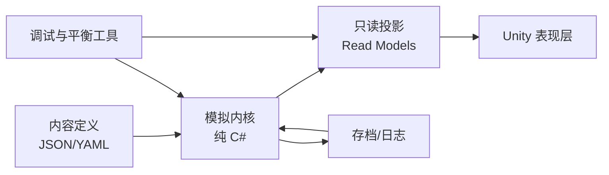
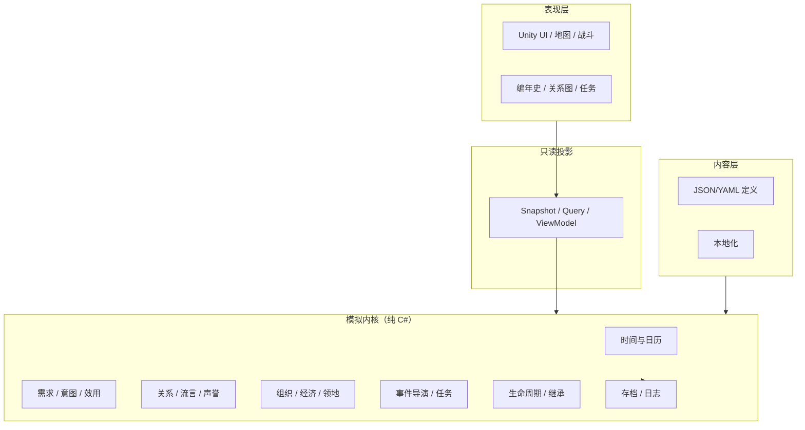

# 世界演化系统复刻设计文档

> 参照对象：《鬼谷八荒》《太吾绘卷》  
> 目标：设计一套可工程化落地的“NPC 社会模拟 + 世界事件演化”系统  
> 版本：v0.3（2026-10-24，全体 NPC 回合闭环、持续因果、定时环境事件与 SQLite 持久化）  
> 文档性质：行为级复刻 / 原创实现规格，不是反编译、资源提取或私服方案

---

## 0. 一页结论

**能做，而且技术难点不在“AI 有多聪明”，而在“状态是否自洽、因果是否可读、性能是否可控”。**

两款游戏给出的共同答案是：

1. **双层时钟**：玩家在月内行动，世界在月末（或时节更替时）批量演化。
2. **规则驱动的 NPC**：性格、需求、关系、实力、风险共同决定行为，而不是每个 NPC 跑一个大模型。
3. **有向关系网**：好感不是唯一变量，还有亲缘、师承、仇恨、债务、立场与流言。
4. **两张图，不是一张表**：人物关系是一张有向多重图，事件因果是另一张事件图。连锁反应 = 「关系图回答谁在乎」×「事件图回答接下来会发生什么」，两图在运行时相乘，再被预算裁剪。
5. **多源事件**：脚本主线、世界压力、日历活动、NPC 涌现事件必须分开建模。
6. **事件日志就是产品**：玩家感知到的“世界在演化”，主要来自可读的生平、传闻、关系和后果，而不是后台数字。

推荐的产品形态是：

> **单机修仙/武侠沙盒；玩家按日或按行动点行动；世界按月做确定性批处理；NPC 拥有有限感知、需求、目标、记忆和关系；世界压力提供长期主线；玩家可以干预，但不能让世界围着自己转。**

本文的工程方案按 **C# / .NET 8 模拟内核 + Unity 表现层** 设计，但架构本身与引擎无关。

**本项目的硬性目标：在明确的模拟范围内，每个独立 NPC 每回合都有可追溯的行动或持续状态；行动与环境事件改变真实世界状态；这些变化通过信息、关系、资源和组织持续影响后续决策；整个过程不依赖玩家是否在场或查看。** SQLite 是正式运行和存档的唯一权威持久化数据库，内存用于回合计算，JSON/YAML 用于内容配置。

v0.3 统一约定：所有独立 NPC 逐回合结算；规划深度可分层，但不得休眠后补写历史；AP 上限 6、主动执行槽位上限 4；计算预算只限制当回合展开量，不限制历史因果长度；导演只选择呈现；环境事件包含开始、持续、结束与余波。

**先做 300 个 NPC、1 个区域、24 个时间刻的垂直切片，再谈千人江湖。** 这是全文最重要的落地建议。

---

## 1. 范围、方法与边界

### 1.1 复刻到哪一层

本文复刻的是**系统行为与体验结构**：

- 世界如何随时间推进；
- NPC 如何在不被玩家观察时继续生活；
- NPC 如何选择行动、形成关系、传播信息；
- 世界事件如何从状态中长出来，并反过来改变状态；
- 玩家如何介入，以及介入后如何留下长期后果。

本文**不**复刻：

- 具体美术、音乐、文本、角色、地名、门派名；
- 原作的数值表、概率表、成长曲线；
- 原作代码、资源包、存档格式；
- 受法律保护的表达性内容。

### 1.2 资料可信度分级

本文把依据分成三类，避免把玩家经验当成官方规则：

| 级别 | 含义 | 用法 |
|---|---|---|
| A | 官方公告、制作人采访、商店页明确描述 | 作为机制存在性的依据 |
| B | 官方 Wiki / 大型攻略站的结构化记录 | 作为流程与交互类型的参考 |
| C | 玩家测试、版本攻略、社区总结 | 只作为设计假设，不硬编码 |

尤其注意：

- 《鬼谷八荒》的公开资料跨越 EA 到 1.0，具体数值和周期随版本变化；
- 《太吾绘卷》在 2022 年做过大规模重构，2026 年完全版又调整了大量交互与结算顺序；
- 两款游戏的“月末结算顺序、候选范围、精确公式”都没有完整公开。

因此，本文只把公开资料用于**确定系统边界和交互类型**，具体公式全部重新设计。

### 1.3 合法边界

游戏规则、机制和玩法思想通常不受著作权保护，但**名称、美术、音乐、剧情文本、角色、地图、UI 视觉、具体数据表**受保护。建议：

- 采用 clean-room（洁净室）流程：只读公开资料和玩家可见行为，不反编译、不拆包；
- 另起原创世界观、角色名、门派名、事件文案；
- 不复制原作的独特术语组合与标志性表达；
- 若要商业化，让律师在立项和上线前各看一次；
- 本文不构成法律意见。

---

## 2. 两款参照物的机制拆解

### 2.1 总览对比

| 维度 | 《鬼谷八荒》 | 《太吾绘卷》 | 工程含义 |
|---|---|---|---|
| 玩家时间 | 以“天”为单位消耗行动，月底进入下月 | 以“时节/月”为单位，月内有行动点 | 都需要“月内玩家行动 + 月末世界结算” |
| 世界结算 | 每月结束演算所有 NPC 的交互并推导结果 | 时节更替时结算 NPC 行为、关系、生死、产业 | 月度批处理是核心性能边界 |
| NPC 驱动 | 性格、背景、动机、实力、关系、物品价值 | 立场、七元赋性、身份、需求行动点、关系 | Utility AI 比行为树/LLM 更适合 |
| NPC 行为 | 修炼、购买、疗伤、社交、偷窃、报仇、收徒、参加活动 | 求医、求财、学习、交友、婚恋、寻仇、偷师、作恶 | 行为必须是“有前置条件的结果” |
| 关系 | 亲族、好友、仇人、道侣、师徒；仇恨会沿关系网扩散 | 父母、夫妻、子女、结义、师徒、朋友、爱慕、仇敌；仇恨可为单向 | 有向多重图，不是单一好感度 |
| 组织 | 宗门有职位、资源点、宗门战、大比、灭宗/分舵 | 门派、城镇、身份品级、升迁补缺、地区恩义 | 组织是独立战略层，不是任务发布器 |
| 世界事件 | 地图随机事件、月末大事件、脚本奇遇、宗门活动 | 世界进度、破冢侵袭、地区剧情、奇遇、时节事件 | 事件必须分源，不能塞进一张随机表 |
| 长期压力 | 境界与区域门槛、宗门竞争、随机强敌 | 精纯/侵袭进度、入魔、剑冢化身侵袭、太吾村存亡 | 需要“世界压力表 + 阶段 + 反制” |
| 代际 | 以单角色成长为主 | 太吾传承、继承武功/遗惠、世代更替 | 世代系统是可选高级模块 |
| 玩家位置 | 玩家是社会网络中的一个节点 | 玩家是制度性角色“太吾传人” | 玩家必须是特殊实体，但不能是全知中心 |

### 2.2 《鬼谷八荒》：玩家按天走，世界按月算

公开资料能确认的骨架：

- 玩家移动、修炼、交易等行为消耗天数，月份用完后进入下月 [S22]；
- 官方商店页强调 NPC 拥有朋友、亲族关系网和“自己的人生轨迹”，并不依附于玩家进度 [S2]；
- 每月结束时，游戏会演算所有 NPC 在当前动机下发生的交互，并推导结果 [S1]；
- NPC 行为动机由性格、背景、双方实力、关系、物品价值等共同影响 [S1][S21]；
- NPC 会自主修炼、购买秘籍、疗伤、交友、赠送、索取、偷窃、报仇、收徒、参加拍卖和宗门大比 [S3][S4]；
- 玩家与 NPC 的互动会波及对方的关系网，可能形成敬仰或追杀 [S5]；
- 大地图按格划分，一部分格刷新随机事件，另一部分留白；随机事件与 NPC 涌现事件不是同一层 [S1]；
- 宗门有独立资源点、每月产出、三年一度的宗门大比、宗门战、灭宗与分舵 [S6]；
- 官方 FAQ 提到 NPC 数量会影响过月耗时，拍卖会、宗门大比所在月份需要额外运算 [S20]。

> 版本提示：宗门大比的周期在不同版本/资料中存在“三年”和“五年”两种说法。复刻时应把它做成可配置项，不要硬编码。

**结论：** 鬼谷的核心不是“每个 NPC 都有复杂人生”，而是**一个可批量结算的社会规则系统 + 大量可被玩家撞见的事件入口**。

### 2.3 《太吾绘卷》：时节更替时，世界自己走一步

公开资料能确认的骨架：

- 官方在完全版说明中把地区故事、剑柄传承、四季表现作为主要内容 [S15]；
- 游戏以“时节”为基本时间单位，12 个月对应 24 节气；玩家月内有行动力，行动力耗尽或主动结束时进入下一时节 [S7][S18][S19]；
- 时节更替时统一结算 NPC 行为、关系变化、健康、产业、事件等；旧版 Wiki 记录存档也发生在时节更替时 [S7]；
- NPC 有过月行为，且过月行为消耗不同类别的行动点（健康、财富、学习、行为、自由），行动点的恢复受立场与七元赋性影响 [S9]；
- 身份有品级，身份影响可用互动；门派/城镇在身份人数不足时会升迁补缺；婚姻会改变身份，子女继承父母身份 [S8]；
- NPC 会恋爱、结婚、生育、衰老、病死，也会结仇、报恩、站队；1.0 增加了 NPC 行为追踪和死后传承 [S12][S17]；
- 世界进度与精纯/侵袭挂钩；剑冢被攻破后，世界压力上升，相枢化身会周期性破冢袭击太吾村；村庄被毁则游戏失败 [S10][S11][S12]；
- 2026 年完全版仍坚持非生成式 AI 的“手工复杂性”，NPC 行为由性格、立场、关系与随机事件推演 [S13]；
- 公开报道常用“数千名 NPC 各自拥有独立人生轨迹”描述其卖点 [S16]。

**结论：** 太吾的核心是**“制度化的世代 + 有世界压力的社会模拟”**。玩家不是唯一主角，太吾只是一个会被继承的职位。

### 2.4 共同模式

把两款游戏抽象后，得到同一套五层结构：

1. **时间层**：玩家行动时间 + 世界批处理时间。
2. **主体层**：NPC 的需求、性格、目标、能力、资源、位置。
3. **关系层**：亲缘、师承、婚恋、友谊、仇恨、债务、阵营。
4. **组织层**：门派/宗门/城镇的资源、职位、领地、战争、活动。
5. **叙事层**：事件、传闻、生平、任务、编年史。

真正让世界“活”的，不是随机数，而是：

> **NPC 在有限信息下做出有动机的选择，选择产生后果，后果进入关系和记忆，关系再影响下一次选择。**

### 2.5 关键差异与设计取舍

| 取舍点 | 鬼谷式 | 太吾式 | 本文建议 |
|---|---|---|---|
| 玩家中心度 | 高，玩家是关系网核心 | 中，玩家是制度角色 | 玩家有“聚光灯”，但世界不围着他转 |
| 时间粒度 | 天 + 月 | 月 + 行动点 | 月为模拟 tick，日内用行动点/天数做表现 |
| 代际 | 弱 | 强 | MVP 不做，二期加“传承”开关 |
| 世界压力 | 区域门槛 + 宗门竞争 | 明确的侵袭/入魔压力 | 必做，否则世界会“静止” |
| 叙事 | 随机奇遇 + 生平 | 涌现传记 + 地区剧情 | 结构化事实 + 模板生成，不用 LLM 掌权 |
| 复杂度 | 中高 | 很高 | 先做“一个区域的社会”，再扩地图 |

---

## 3. 目标系统定义

### 3.1 设计支柱

1. **自治但可读**：NPC 会自己做事，但玩家能看懂“他为什么这么做”。
2. **因果可追溯**：每个重要事件都有前因、参与者、后果，不靠旁白硬拐。
3. **持续存在**：玩家离开三年，回来时人、组织、关系都变了，但变化有迹可循。
4. **玩家有分量**：玩家能改变局部世界，但无法轻易让所有人围着自己转。
5. **确定性可复现**：同一种子 + 同一输入 = 同一结果，便于测试、回放和修 bug。
6. **有界计算**：NPC 多时减少候选搜索和完整重规划频率，但保留每个 NPC 每回合的执行与状态结算。
7. **数据驱动**：行为、事件、对话、平衡参数尽量配置化。

### 3.2 非目标

- 不做真实物理、流体、天气灾害的全模拟；
- 不做完整宏观经济学；
- 不让 LLM 直接修改权威状态；
- 不做 MMO / 多人同步；
- 不在 MVP 阶段模拟每个人每分钟的活动，但所有独立 NPC 必须逐回合结算；
- 不追求“每个 NPC 都能生成一篇小说”，先追求“每个重要 NPC 都有一条能讲通的人生线”。

### 3.3 核心体验循环

```
玩家行动（移动/修炼/交谈/交易/战斗/建设）
        ↓
消耗时间，触发局部事件
        ↓
月末：世界批量演化（NPC 行动、组织决策、世界压力）
        ↓
玩家通过生平、传闻、关系变化、地图变化感知世界
        ↓
玩家选择介入或忽略
        ↓
新的状态与新的矛盾
```

### 3.4 三层世界

这是整个架构最重要的分层：

| 层 | 内容 | 谁能读 | 用途 |
|---|---|---|---|
| **真值层** | 所有实体的真实状态、真实关系、真实事件 | 模拟内核 | 权威数据，唯一可写 |
| **信念层** | 每个 NPC 知道什么、相信什么、怀疑什么 | 该 NPC 的 AI | 防止全知，制造误会与戏剧 |
| **叙事层** | 编年史、传闻、任务描述、人物生平 | 玩家/UI | 只读投影，可裁剪、可美化 |

**不要让 NPC 直接查询真值层来做决策。** NPC 只能通过“感知”获得局部事实，再基于信念行动。这是“活世界”与“全知 NPC”的分水岭。

### 3.5 高层架构图



---

## 4. 时间与 Tick 管线

### 4.1 双时钟

| 时钟 | 单位 | 谁使用 | 规则 |
|---|---|---|---|
| 玩家时钟 | 日 / 行动点 | 玩家 | 移动、修炼、交谈、战斗消耗；耗尽后进入月末 |
| 世界时钟 | 月（tick） | NPC、组织、经济、事件 | 所有批量结算在此发生 |
| 季节时钟 | 3 tick | 环境、节庆、产业 | 资源产出、疾病、迁移修正 |
| 年度时钟 | 12 tick | 宗门大比、赋税、人口统计 | 年度级事件 |
| 世代时钟 | 多年 | 传承、家族、世界阶段 | 二期功能 |

设计上不要把“一个月固定 30 天”写死。用 `daysPerMonth` 配置，UI 可以显示三十天，但逻辑只关心“本月剩余行动”。

### 4.2 月度管线

每个 tick 按固定阶段执行。阶段之间设**屏障**：上一阶段的效果全部提交后，下一阶段才能读取新状态。

| 阶段 | 名称 | 主要工作 | 输出 |
|---|---|---|---|
| P0 | 锁定与快照 | 锁定输入，记录 tick 起始哈希 | TickContext |
| P1 | 日历 | 推进月份、季节，准备本回合基础环境参数 | 日历状态 |
| P2 | 到期事件与环境 | 启停环境事件、应用当回合修正，再结算资源再生、消耗、建筑进度及到期预约 | 已生效环境与资源状态 |
| P3 | 组织战略 | 宗门/城镇/家族的季度战略 + 月度执行：招募、建设、战争、贸易 | 组织意图 |
| P4 | NPC 需求 | 更新健康、资源、修为、安全、归属、声望、恩怨 | 需求向量 |
| P5 | NPC 意图 | 每个 NPC 为当前执行轮选择一个可执行步骤，含续行与 Directive 响应；AP 最多 6、主动执行槽位最多 4 | 本轮 Intent 列表 |
| P6 | 移动与到达 | 旅行、赶路、追踪、逃亡；处理到达与拦截 | 位置变化 |
| P7 | 交互配对与结算 | 同地社交、交易、偷窃、袭击、传功、婚恋 | 交互结果 |
| P8 | 生命周期 | 伤病、怀孕、生育、衰老、死亡 | 生死与人口变化 |
| P9 | 继承与补缺 | 财产、职位、功法、债务、仇恨的继承；空位补选 | 身份变化 |
| P10 | 社会传播与因果延展 | 直接关系变化、第三方反应、流言扩散、声誉；沿关系图与事件图展开后继（8.10） | 关系/信念变化 + 新事件节点 |
| P11 | 世界压力与呈现 | 规则引擎推进危机并预约后继；导演只筛选已有事实与可见局势、投影任务钩子 | 待办 + 展示列表 |
| P12 | 持久化与投影 | 检查回合覆盖与不变量，SQLite 原子提交状态、日志、队列和回合号；成功后发布投影 | 已提交新状态 |

**P5–P7 是有界执行循环，最多 4 轮。** 每轮先选择一步，再移动与交互，结算后更新参与者可知信息，下一轮重新校验依赖和资源。所有 NPC 在同一轮完成后才进入下一轮；剩余 AP 或时间不足者只记录等待/续行状态。P3 发令占用的槽位与 AP 预先计入同一预算。循环后才进入 P8。P10/P11 产生的主动行为最早在下一 tick 执行，不回跳到 P5。

> 《太吾绘卷》的官方补丁日志曾专门调整“怀胎、监牢惩罚、产业资源、满仓遗失”等阶段的先后顺序 [S14]。这说明月度管线的**顺序本身就是玩法**，不能把它当成无关紧要的实现细节。

**为什么是这个顺序？**

- 先环境、再组织、再个人：组织策略会影响 NPC 的机会与约束；
- 先意图、再移动：避免 NPC 先瞬移再决定要去哪；
- 先交互、再生死：让“最后一击/最后一面”发生在同一 tick；
- 先继承、再传播：死亡后的财产和职位变化，才能被其他人正确感知；
- 先传播、再导演：导演看到的是“已经发生变化的世界”，而不是旧状态；
- 延展紧跟传播：关系图先算出“场外谁受到了影响”，事件图再决定“他们会不会行动”，连锁产生的节点因此能在同一 tick 进入导演视野；
- 阶段末更新本 tick 的内存工作状态，P12 才一次性持久化：后续阶段可读新状态，外部读者只看到完整提交的回合。

### 4.3 效果队列与事务

所有行为不直接改状态，而是产生 `Effect`：

```text
Effect {
  kind: RelationDelta | HealthDelta | ResourceDelta | Move | TitleChange |
        ItemTransfer | KnowledgeGain | Spawn | Despawn | EventEmit
  sourceEventId
  targetId
  payload
  priority
}
```

在阶段末统一应用。好处：

- 同一 tick 内多个行为冲突时，有明确的优先级与稳定排序；
- 可以记录“谁导致了什么”，便于因果链和回放；
- 可以在应用前做合法性校验；
- 测试可以直接断言 Effect 序列，而不是断言最终黑盒状态。

冲突规则：

1. 先按 `priority`（系统级 > 组织级 > 个人级）；
2. 同优先级按 `(sourceEventId, effectSeq)` 稳定排序，每个效果有唯一幂等键；
3. 同一目标的互斥效果（如“死亡”和“结婚”）由领域规则拒绝后者；
4. 被拒绝的效果写入 `rejected_effects`，供调试，不可静默丢失。

交易、赠与、抢夺等复合操作必须作为一个效果组校验与应用：扣款、转移物品和记账全部成功或全部不生效。执行时重新校验库存、位置、存活和占用，防止两个 NPC 同时购买最后一份药。效果组之间按稳定顺序结算，组内不暴露半完成状态；伤亡/资源占用立即影响后续组。

**重伤与死亡标记要即时生效。** 否则同一 tick 中“已被击杀的人”仍可能继续行动。推荐做法：P7 结算时写入 `incapacitated` / `dead_pending` 状态，立即阻止后续意图与关系创建；真正的实体清理、继承和讣告留到 P8/P9。

### 4.4 玩家打断协议

月末结算时，如果某个 NPC 行为直接指向玩家（袭击、求婚、求助、揭发），不要让模拟内核“替玩家做决定”。

推荐：

1. 该行为生成 `PendingEncounter`；
2. 模拟暂停在当前 P7 交互之前，将内存工作状态、阶段/轮次/游标、已应用效果键和队列保存为 SQLite 独立检查点；权威回合仍停在上一已提交 tick；
3. 客户端接管，玩家选择战斗/交谈/拒绝/贿赂/逃跑；
4. 玩家结果作为一条 `PlayerCommand` 写回；
5. 从暂停点继续，保证同一 tick 的其余行为仍按原顺序结算。

等待期间不持有 SQLite 写事务，也不因现实时间超时自动推进。玩家主动选择托管时，默认保守行为作为一条明确命令保存。读档恢复检查点后从下一未执行交互继续，已应用效果不得再应用。

### 4.5 确定性规则

必须写进代码规范：

- 禁止 `DateTime.Now`、`Random.Shared`、无序 `HashSet` 迭代进入模拟；
- 所有实体 ID 为稳定的 64 位整数；
- 所有阶段按 `id` 升序处理；
- 所有随机数来自命名流，不使用全局随机；
- 核心状态用整数或定点；AI 打分可以用 `double`，但比较和加权抽样前必须量化为定点（如 1/10000），避免浮点误差改变排序；
- 存档必须保存随机流状态、待处理队列、预约事件；
- 并行只允许“读并行、写串行”，并在合并时稳定排序。

随机流建议：

```csharp
ulong Rand(Stream s, long tick, long a, long b = 0) {
    ulong x = worldSeed;
    x ^= (ulong)s * 0x9E3779B97F4A7C15UL;
    x ^= (ulong)tick * 0xBF58476D1CE4E5B9UL;
    x ^= (ulong)a * 0x94D049BB133111EBUL;
    x ^= (ulong)b * 0xD6E8FEB86659FD93UL;
    return SplitMix64(x);
}
```

这样即使并行顺序变化，每个实体的随机结果也不变。

### 4.6 Tick 伪代码

```csharp
void Tick(World committed) {
    var ctx = BeginWorkingTick(committed);
    RunStage(ctx, Calendar.Advance);
    RunStage(ctx, Environment.ResolveDueAndApply);
    RunStage(ctx, FactionAI.PlanAndAssign);
    RunStage(ctx, Needs.UpdateAll);
    for (int round = 0; round < 4; round++) {
        RunStage(ctx, Intent.SelectNextForAll);
        RunStage(ctx, Movement.Resolve);
        RunStage(ctx, Interactions.Resolve);
        RunStage(ctx, Actions.FeedbackAndReplan);
    }
    RunStage(ctx, Lifecycle.Resolve);
    RunStage(ctx, Succession.Resolve);
    RunStage(ctx, Society.DeliverKnowledgeAndReact);
    RunStage(ctx, Cascade.DrainDueWork);
    RunStage(ctx, WorldPressure.AdvanceAndSchedule);
    Director.SelectExistingFacts(ctx);
    Coverage.FinalizeAllNpcTurns(ctx);
    Invariants.Validate(ctx);
    Storage.CommitTickAtomically(ctx);
    Projection.Publish(ctx);
}
```

`RunStage` 包含内存效果组校验与应用。伪代码省略了暂停返回与异常分支：遇到玩家交互时保存检查点并退出；任一阶段失败时保留上一已提交回合，不继续到 P12。

---

## 5. 世界模型

### 5.1 实体清单

| 实体 | 说明 | 关键字段 |
|---|---|---|
| `World` | 世界根 | seed、tick、pressure、flags、配置版本 |
| `Region` | 大区域/州 | 地形、危险度、资源倾向、归属 |
| `Locale` | 城镇/门派/村落/遗迹 | 位置、人口、势力、资源、设施 |
| `Site` | 资源点/建筑/副本入口 | 类型、产出、耐久、占领者 |
| `Faction` | 宗门/家族/城镇势力 | 资源、目标、关系、职位、领地 |
| `Npc` | 具名 NPC | 身份、属性、需求、目标、位置、背包 |
| `Cohort` | 匿名人口 | 数量、年龄结构、职业、迁移倾向 |
| `Relation` | 有向关系 | 类型、好感、信任、恐惧、债务 |
| `EventEdge` | 事件因果边 | 起点事件、终点事件、因果类型、权重 |
| `Directive` | 委派命令 | 下令者、目标、优先级、期限、委派深度 |
| `Intent` | 本月意图 | 类型、目标、地点、优先级、截止 |
| `Event` | 已发生事件 | 参与者、因果、可见性、显著性 |
| `Situation` | 未解决的张力 | 利害、期限、可选干预 |
| `Contract` | 任务/契约 | 目标、期限、奖励、来源事件 |
| `Activity` | 活动 | 大比、拍卖、婚礼、战争、危机 |
| `Memory` | NPC 记忆 | 事件、情绪权重、来源、衰减 |

### 5.2 空间模型

采用三层：

```
Region（州/大区）
  └─ Locale（城/镇/门派/村落）
       └─ Site（资源点/建筑/奇遇入口）
```

- `Region` 之间用图连接，边权 = 旅行天数；
- `Locale` 是 NPC 日常活动的容器，也是“同地交互”的判定单位；
- `Site` 提供资源、工作、事件、战斗入口；
- 战斗/遭遇用局部网格或抽象距离，不需要全图导航网格。

旅行：

- `MoveIntent` 只记录目标 `locale`，不记录每一格；
- 路径由区域图最短路生成，带风险与费用；
- 到达时间 = 距离 / 速度 + 事件延迟；
- 玩家可以看到 NPC 的“预计到达”，但 NPC 自己只知道大致路程。

### 5.3 具名 NPC 与匿名人口

不要把所有人口都做成具名 agent。

| 层级 | 数量级 | 模拟方式 |
|---|---|---|
| 核心 NPC | 50–200 | 全量：需求、意图、关系、记忆、事件 |
| 重要 NPC | 1k–5k | 全量 AI，但降低候选范围与记忆长度 |
| 背景 NPC | 5k–20k | 简化候选搜索，但逐回合感知、决策/续行、执行、反馈与记录 |
| 匿名人口 | 大量 | Cohort：只参与经济、兵源、舆论、迁徙 |

这样既保留“街上的人都有名字”的体验，又不会让 tick 变成 O(n²)。

“每个 NPC”指全部独立建模、具有稳定 ID 的人物，包括背景 NPC。Cohort 是明确标注的匿名人口统计，不提供个人人生保证；如果产品要求每个居民都有完整人生，该居民必须从生成时就建成 NPC。匿名人口转为 NPC 时保存来源与生成时刻，不虚构其此前逐回合行为。

### 5.4 经济与资源

不要做完整市场经济。做**局部资源存量 + 月度产出/消耗 + 价格信号**：

- 每个 `Site` 有资源存量、产出率、上限；
- 每个 `Locale` 有食物、药材、矿石、布料、灵石等聚合库存；
- 人口消耗、建筑消耗、宗门军费是主要 sink；
- 商队/贸易路线把资源从富余地运到短缺地；
- 价格 = 基础价 × 稀缺系数 × 地方修正 × 事件修正；
- 玩家交易会改变局部库存和价格，但不直接改写全局经济。

关键平衡：

- 资源必须有稳定 sink，否则通货膨胀；
- 战争、灾害、封锁要能造成真实短缺；
- NPC 的“求财/求物”行为要能在经济里找到对应物，而不是凭空生成。

### 5.5 组织与领地

`Faction` 是独立战略主体，至少包含：

- 类型：宗门、家族、城镇议会、商帮、邪派；
- 资源：资金、粮、材料、威望、人力；
- 职位：掌门、长老、真传、内门、外门、客卿；
- 领地：直接控制 + 影响范围；
- 目标：扩张、守成、复仇、求财、传道、研究；
- 关系：同盟、停战、竞争、世仇；
- 日程：年度大比、季度会议、战争准备。

组织 AI 不需要每月全量思考。推荐：

- **季度战略 tick**：评估资源、威胁、机会，设定季度目标；
- **月度执行 tick**：招募、征税、建设、派遣、外交；
- **紧急 tick**：领地被打、掌门死亡、资源枯竭时立即重规划。

这样既省性能，又让组织行为有“计划感”。

### 5.6 世界压力

世界压力是长期主线的发动机。没有它，社会模拟会逐渐“稳定得无聊”。

设计一个 0–100 的 `Pressure`，按阶段生效：

| 阶段 | 压力 | 世界表现 | 玩家可选反制 |
|---|---|---|---|
| 0 平静 | 0–19 | 正常社会，少量传闻 | 无 |
| 1 异动 | 20–39 | 怪物增多、物价波动、迁徙 | 调查、清剿 |
| 2 扩散 | 40–59 | 区域危险上升、NPC 入魔/堕落 | 守护要地、救助 |
| 3 侵袭 | 60–79 | 定时袭击、组织倒戈、道路中断 | 防守、结盟 |
| 4 崩坏 | 80–99 | 大规模战争、城市沦陷 | 决战、迁移 |
| 5 终局 | 100 | 家园被毁/最终战 | 终局任务 |

压力来源：

- 时间自然增长；
- 玩家变强/推进主线；
- 组织战争、屠杀、灾难；
- 玩家忽视某些危机。

压力不是“只涨不降”。玩家和 NPC 的关键行动应能降低压力，形成“努力有反馈”的循环。

### 5.7 世界生成

生成顺序：

1. 地形与区域图；
2. 城镇、门派、资源点；
3. 势力分布与初始边界；
4. 人口 cohort；
5. 核心 NPC 与家族；
6. 初始关系网（亲缘、师承、好友、仇敌、债务）；
7. 经济初值（确保没有一开始就饿死全城）；
8. 初始张力（3–5 个可被玩家发现的矛盾）；
9. 约束校验（年龄、亲缘、职位、资源）。

生成后必须跑一个“静默 12 tick”：

- 检查人口是否崩溃；
- 检查是否所有 NPC 都迅速变成同一境界；
- 检查是否所有关系都变成仇敌；
- 检查是否出现“某家族垄断全部职位”；
- 不满足就调整参数，而不是上线后让玩家踩雷。

---

## 6. NPC 模型

### 6.1 数据分层

| 层 | 内容 | 更新频率 |
|---|---|---|
| 身份 | id、姓名、性别、出生、家族、籍贯 | 极少 |
| 属性 | 根骨、悟性、魅力、体质、意志 | 成长时 |
| 状态 | 健康、伤势、中毒、疲劳、心情 | 每月/事件 |
| 能力 | 境界、功法、技艺、战力评级 | 每月 |
| 资源 | 金钱、物品、地盘、人脉 | 事件/每月 |
| 需求 | 安全、健康、财富、修为、归属、声望、恩怨 | 每月 |
| 目标 | 终身志向、阶段目标、本月意图 | 月/季/年 |
| 关系 | 有向关系边 | 事件 |
| 信念 | 知道的事实、传闻、怀疑 | 事件/传播 |
| 记忆 | 重要事件 + 情绪权重 | 事件，缓慢衰减 |

### 6.2 性格与价值观

不要只用“善恶”一个轴。建议 6 个连续轴（-100 到 100）：

| 轴 | 低 | 高 | 影响 |
|---|---|---|---|
| 道义 | 利己 | 守义 | 是否愿意伤害无辜、是否守信 |
| 秩序 | 叛逆 | 守序 | 是否服从组织、是否挑战权威 |
| 亲和 | 冷漠 | 热情 | 社交频率、是否容易建立信任 |
| 野心 | 安于现状 | 渴求上位 | 竞争职位、冒险、背叛概率 |
| 冲动 | 谨慎 | 鲁莽 | 风险偏好、冲突升级 |
| 好奇 | 保守 | 探索 | 旅行、研究、奇遇倾向 |

再叠加 10–20 个标签：记仇、护短、贪财、痴情、嗜武、怕死、重诺、多疑、仁心、好名。

**标签不是装饰**，必须进入效用函数。例如：

- `记仇`：对仇敌的行动权重 +，仇恨衰减 -；
- `护短`：对亲友受害的反应强度 +；
- `贪财`：偷窃/抢夺的收益权重 +，风险权重 -；
- `怕死`：战斗/复仇的 risk penalty +。

### 6.3 需求与目标

需求不是“心情条”，而是行为压力的来源。

| 需求 | 不足时的行为倾向 |
|---|---|
| 安全 | 逃离危险、投靠强势力、购买防护 |
| 健康 | 求医、疗伤、解毒、休息 |
| 财富 | 工作、交易、借贷、偷窃、抢劫 |
| 修为 | 修炼、寻资源、求师、夺功法 |
| 归属 | 交友、结婚、加入组织、收养 |
| 声望 | 参加大比、行侠、炫耀、挑战强者 |
| 恩怨 | 报复、索债、揭发、和解 |

目标分四级：

```
终身志向（成为掌门 / 为家族复仇 / 找到失散亲人）
  └─ 阶段目标（三年内进入内门 / 攒钱买药）
       └─ 本月意图（去城里卖药 / 拜访师父）
            └─ 具体行动（移动 / 交谈 / 交易）
```

每月只重评“本月意图”，阶段目标在季末或失效时重评。这样既稳定又不会僵化。

### 6.4 感知与信念

NPC 的决策输入必须是**局部感知**：

```text
Perception.Sense(npc) =
  自己状态
  + 当前地点可见人物（同 locale）
  + 直接关系人的公开状态
  + 自己知道的传闻
  + 组织公告
  + 当地物价/危险度
```

不允许：

- NPC 直接读取玩家背包；
- NPC 知道千里之外的杀人凶手；
- NPC 知道未公开的掌门密谋；
- NPC 根据全局最优解行动。

信念条目：

```text
Belief {
  factId
  subject: 谁
  predicate: 做了什么
  object: 对谁/什么
  confidence: 0..100
  source: 亲眼/亲友/传闻/公告
  firstHeardTick
  lastUpdatedTick
}
```

同一事实可以有不同版本。NPC 可能“确信一个错误版本”，这就是误会、冤案、私奔、错杀的故事来源。

### 6.5 效用 AI

每个候选行为打分，硬条件先过滤：

```text
U(action) =
    W_goal      * goalFit(action)
  + W_need      * needFit(action)
  + W_persona   * personalityFit(action)
  + W_relation  * relationFit(action)
  + W_gain      * expectedGain(action)
  + W_status    * statusFit(action)
  - W_risk      * perceivedRisk(action)
  + W_mood      * moodBias(action)
  + W_habit     * habitBonus(action)
  + noise
```

约束：

- 行动必须有合法目标、地点、资源；
- 目标必须在该 NPC 的感知范围内；
- 有冷却、次数上限、身份限制；
- **每个 NPC 的月度行动量由 AP、时间和槽位共同限制**（普通成人 AP 2，高身份最多 AP 6，主动槽位最多 4），按实际行动成本扣减，详见 6.13–6.14；
- 玩家可以看到“为什么”面板，显示前三项得分来源。

选择方式：

- 先取 Top-K（K=5）；
- 用带温度的加权随机，避免每次都选同一最优解；
- 对“高风险/高戏剧性”行为加探索噪声，但设置硬上限，防止世界变成随机杀人现场。

### 6.6 行为目录（MVP）

| 类别 | 行为 | 主要前置 | 主要后果 |
|---|---|---|---|
| 生存 | 疗伤、解毒、休息、购买药 | 有伤/毒/钱 | 健康恢复、财富减少 |
| 成长 | 修炼、研读、突破、求师 | 时间/资源/境界 | 修为、境界、失败受伤 |
| 经济 | 工作、采集、买卖、借贷 | 地点/技能 | 资源、价格、债务 |
| 社交 | 交谈、赠礼、宴请、结拜 | 同地/关系 | 好感、信任、传闻 |
| 婚恋 | 表白、求婚、结婚、生育 | 年龄/单身/好感 | 关系、家族、人口 |
| 组织 | 入门、晋升、任务、叛逃 | 身份/贡献 | 职位、资源、阵营 |
| 冲突 | 挑战、偷窃、袭击、复仇 | 仇恨/实力/机会 | 伤、死、仇恨、通缉 |
| 探索 | 旅行、探秘境、寻宝 | 情报/实力 | 物品、知识、风险 |
| 教导 | 授业、收徒、传功 | 关系/造诣 | 徒弟成长、恩义 |

### 6.7 行动结算

以社交行动为例：

```text
outcomeScore =
    actor.charm * 0.25
  + actor.status * 0.20
  + relation.affinity * 0.20
  + giftValue * 0.15
  + compatibility * 0.10
  + mood * 0.10
  - target.suspicion * 0.20
  + rng(-10, 10)
```

结果分五档：

| 档位 | 条件 | 结果 |
|---|---|---|
| 大成功 | 超过阈值 20+ | 关系大步提升，产生额外事件 |
| 成功 | 超过阈值 | 关系提升，目标记住 |
| 勉强 | 阈值附近 | 小幅变化，可能留下隐患 |
| 失败 | 低于阈值 | 关系下降，目标不悦 |
| 大失败 | 低于阈值 20+ | 关系恶化、仇恨、公开冲突 |

战斗不要在每个 NPC 之间跑完整战棋。用抽象战力结算：

```text
power = realm * 10 + technique * 5 + equipment * 3 + terrain + allies + injuryPenalty
```

玩家参与时，才切入战术战斗；NPC 对 NPC 用抽象结算，结果是伤亡、被俘、逃跑、掠夺。

### 6.8 成长与突破

月度成长：

```text
progressGain =
    baseRate
  * talentFactor
  * resourceFactor
  * focusFactor
  * healthFactor
  * (1 + mentorBonus)
  * (0.8 + rng * 0.4)
```

突破：

- 需要修为满、材料、领悟、安全环境；
- 成功率受资质、功法、丹药、心境影响；
- 失败可能受伤、掉修为、结下心魔；
- 高境界有名额/资源瓶颈，避免所有人一起飞升。

**关键平衡：** NPC 的成长必须消耗世界资源。否则几十年后满地图都是高境界，社会模拟失去层次。

### 6.9 生命周期

- 年龄以月计，寿命有随机区间；
- 健康受年龄、伤病、毒、生活条件影响；
- 怀孕、生育需要父母、年龄、关系、资源条件；
- 儿童在 14 岁前只做简化行为，不参与婚恋/战斗/高位；
- 死亡触发继承、葬礼、仇恨、职位补缺、传闻；
- 重要 NPC 死亡应生成“讣告/传记”事件，而不是静默删除。

### 6.10 继承

死亡时按以下顺序处理：

1. 直系亲属/配偶/指定继承人；
2. 无继承人则按组织规则/遗嘱/关系最近者；
3. 财产、债务、功法、职位分别处理；
4. 仇恨与恩义部分继承（不是简单复制，要有折扣）；
5. 继承人可能年幼，由摄政/师父代管；
6. 产生“继承纠纷”Situation，供玩家介入。

这比“掉一个箱子”更能产生长期故事。

### 6.11 LOD 与预算

| 模式 | 触发 | 模拟精度 | 决策深度 |
|---|---|---|---|
| Full | 核心 NPC/高复杂度职责 | 完整回合闭环，较大候选集 | 2–3 步规划，按需重规划 |
| Focused | 重要 NPC/较复杂目标 | 完整回合闭环，较小候选集 | 2 步前瞻 |
| Background | 普通 NPC | 完整回合闭环，局部候选与缓存 | 单步效用或继续现有计划 |

**不设置 Dormant 模式，不允许跳过回合后概率补写历史。** 分层依据身份、职责和目标复杂度，与玩家是否查看无关。玩家靠近可以增加 UI 展示细节，不能改变同种子下 NPC 的事实进程。

- 所有 NPC 每 tick 都更新需求、健康、持续任务、获知信息和行动反馈；
- 允许缓存候选与长期计划，但执行前必须校验；重大伤亡、道路阻断、命令变化等立即使相关缓存失效；
- 可以压缩旧日志或按规则减少搜索候选，但不得遗漏既有行动、必达通知、持续效果和任务进度；
- 日志摘要只投影已发生事实，不生成新的历史；性能不达标时先缩小世界人数、优化索引或增加结算耗时，不牺牲逐回合覆盖率。

### 6.12 一个 NPC 的月份（示例）

> 沈砚，22 岁，药铺学徒，根骨平平，妹妹患病，欠债 30 灵石。性格：高亲和、中秩序、高护短、低野心。本月需求：健康 40、财富 15、修为 55、归属 60。

1. 感知：城里药材涨价；债主在茶馆；妹妹病情恶化。
2. 目标：本月先筹药费。
3. 候选：加班抓药、向师父借钱、偷药铺的人参、去城外采药、抢劫路人。
4. 打分：偷窃收益高但风险高（怕事、秩序中高，扣分）；采药风险中，收益中；借钱保关系但欠人情。
5. 选择：白天出城采药（AP 1），回来卖药并入采药结算；再用 1 点向师父开口借钱。本月 AP 见底。
6. 结算：采药成功，但遇到野兽受伤；卖药赚到钱；师父借钱但要求他下月替工。
7. 后果：财富 +、健康 -、欠师父人情、妹妹病情稳定；债主听说他有钱，下月来催债。
8. 传播：茶馆里有人看到他卖药，传闻“沈砚发了财”；债主信念更新。
9. 下月：债主可能上门，师父可能催工，妹妹可能康复或恶化。

这就是一个可解释、可累积、可被玩家介入的最小故事单元。

### 6.13 身份、权限与行动预算

先分清四个维度，它们经常被混成一句“大佬更强”：

| 维度 | 普通 NPC | 特殊 NPC | 实现约束 |
|---|---|---|---|
| 能做哪些事 | 基础白名单 | 更多身份与职务权限 | 执行前校验当前身份 |
| 每回合做几次 | 通常 AP 2 | AP 上限 6 | 全体主动执行槽位上限 4 |
| 影响多大范围 | 通常本地 | 跨地点、跨区域 | 权限与通信/旅行分别校验 |
| 让别人替自己做 | 协商或请求 | 具有权威的委派 | 发令与执行各自消耗预算 |
| 想得多深 | 单步最优 | 2–3 步规划 | 身份决定深度，事件触发重规划 |

通过 **AP 预算、权限与 reach、委派** 表达差异；所有人物共用 6.14 的回合闭环与行动状态机。

#### 6.13.1 行动预算（AP）

把“1 主 + 1 轻”换成可变的行动点：

```text
apBudget(npc) =
    base                 // 2（成年常人；14 岁以下或重病者 1）
  + rankBonus(rank)      // 外门 0，内门 +1，真传 +2，长老 +3，掌门 +4
  + officeBonus(office)  // 有实职 +1
  + healthBonus(health)  // 健康 <40 时 -1，<20 再 -1
  + traitBonus           // 精力充沛 +1，伤病缠身 -1
  - agePenalty           // 老年 -1
clamp 0..6
```

行动按成本消耗：

| 档 | 成本 | 例子 |
|---|---|---|
| 轻 | 1 | 交谈、打听、小额买卖、短途采药、修炼一日 |
| 中 | 2 | 出诊、赴宴、巡逻、探望、远程采药 |
| 重 | 3 | 突破、远行、决斗、主持大比 |
| 极重 | 4 | 开战、闭关、长期任务 |

选择逻辑为“本轮选择一步、执行反馈后再选”，不是在回合起点一次装满所有行动。AP 与时间分别计量；长期行动必须配置可分期的工作量，普通 NPC 也能通过多回合完成远行、突破等任务。不可分割的即时行动才要求本轮拥有全部 AP。

```csharp
Intent SelectNextIntent(Npc npc, TickContext context) {
    if (!CanAct(npc, context)) return RecordPassiveState(npc, context);
    var view = Perception.For(npc, context);
    var candidates = Plans.ReadyStepsAndAlternatives(npc, view)
        .Where(step => FitsRemainingBudget(step, npc, context))
        .OrderByDescending(step => QuantizedUtility(step, view))
        .ThenBy(step => step.StableId)
        .ToList();
    return SelectOrWait(candidates, npc, context);
}
```

普通 NPC 的 `ap = 2`，可以完成两件 AP 1 的小事，也可以投入一件 AP 2 的任务。身份高的 NPC 有更多行动预算，但仍受时间、槽位与前置条件约束。

但要清楚一点：AP 只决定“能做几次”，不保证“每次都成”。掌门三次行动全失败，比药童做成一次还惨，这是应该的。

#### 6.13.2 权限与影响半径

前置条件从“布尔身份判断”升级成四类：

| 条件 | 语义 | 例子 |
|---|---|---|
| `requires.role` | 身份/品级白名单 | 收徒：rank ≥ 真传 |
| `requires.office` | 实职 | 开战：office = 掌门 |
| `requires.authority` | 对目标的权威阈值 | 处置门人：authorityTo(target) ≥ 40 |
| `requires.reach` | 作用范围权限 | 清洗异己：目标属于可管辖势力范围 |

`reach` 分级：

| reach | 范围 | 谁有 |
|---|---|---|
| `SELF` | 仅本人 | 所有人 |
| `LOCAL` | 同地点 | 默认 |
| `REGION` | 同区域任意地点 | 长老、城主、商队首领 |
| `FACTION` | 势力全部领地 | 掌门、家主 |
| `WORLD` | 跨势力 | 顶尖强者、世界事件角色 |

`reach` 表示权限与可组织的作用范围，不表示全知、瞬移或免受远方影响。各范围可能重叠而非简单大小排序，例如势力领地可跨区域，校验时按目标集合判断。普通人也会因远方断粮而受影响，可以得知消息、迁移、求援；只有远程发令、跨地征调等行为受相应权限约束。远程行动还必须通过通信通道、送达时间、当地执行者和目标可达性校验。

#### 6.13.3 委派：影响面不靠单体 AP 爆炸

这是最关键的一条。高身份 NPC 的影响面，应该体现为**让别人替他行动**，而不是自己一回合动十次。

```text
Directive {
  id
  issuerId              // 谁下的令
  objective: { kind, targetId?, locationId?, amount? }
  priority
  deadlineTick
  delegationDepth       // 最多 2，防止“掌门→长老→弟子→再外包”
  state: Issued | Accepted | Refused | Executing | Done | Failed | Expired
}
```

流程：

1. P3 组织战略产出目标（“本月清剿西郊妖兽”）；
2. 掌门/长老把它翻译成 1–3 条 Directive，**按 reach 和服从度挑人下发**，不是群发；
   一次发令行动最多包含 3 条命令，消耗下令者 AP 1 与一个执行槽位；P3 发令必须预留该预算，预算不足则排队。异地命令通过消息队列送达，收令者只有获知后才能响应。
3. 收到指令的 NPC 在 P5 把它当作一个高权重候选意图，权重由服从度决定：

```text
obedience = authorityTo(issuer) * 0.4
          + trust               * 0.2
          + fear                * 0.1
          + interestAlignment   * 0.2
          - riskToSelf          * 0.1
```

4. 接受 → 生成执行意图；拒绝 → 回写 `Refused`，下令人获得信念“他不听我的”，可能触发权威下降或秋后算账；
5. 完成/失败都回写组织和下令人，掌门因此有了可观测的“领导力”，而不是一个抽象数值。

服从公式各输入归一化到 0–1，结果截断到该范围并量化。恐惧提高短期服从，但可通过独立记忆效果增加怨恨；不能把即时服从与长期忠诚视为同一数值。

结果：掌门用有限预算发动多个地点的协作；在每个下令者最多 3 条、深度最多 2 且一条命令绑定一个执行者的 MVP 规则下，一批命令最多涉及 3 个一级收令者与 9 个二级收令者。异地送达可能跨回合，所有执行者仍消耗自己的 AP、时间与资源，不产生免费行动。

三条硬限制：

- `delegationDepth ≤ 2`（掌门 → 长老 → 执行者，到顶）；
- 单个 issuer 每 tick 最多下发 3 条，避免“命令风暴”；
- Directive 必须有 deadline，过期转张力，不允许永久挂在世界上。

#### 6.13.4 决策深度分层

| 类型 | 规划方式 | 覆盖 |
|---|---|---|
| 普通 | 单步效用（本轮最优） | 约 90% NPC |
| 重要 | 2 步前瞻（这个月做 A，下个月才够得着 B） | 具名 NPC、有长期目标者 |
| 核心 | 3 步 + 目标分解（把“夺位”拆成本月结盟、下月收集把柄） | 掌门、主要反派、玩家熟人 |

深层规划不能每 tick 全跑。做法是给核心 NPC 一条**低频深算通道**：每 3 tick 跑一次完整规划，结果缓存为“当前计划”，其余 tick 只执行计划并根据突发事件做局部重规划。

否则会出现一个很出戏的现象：玩家不在场时大佬毫无动静，玩家一靠近他突然开始三步走——因为 LOD 一升级，决策深度跟着变了。缓存计划就是为了消掉这条接缝。

#### 6.13.5 同一座城里，两类人的一个月

| | 药童（AP 2） | 掌门（AP 5） |
|---|---|---|
| 行动 | 采药 1、向师父借钱 1（AP 用尽；卖药作为采药任务的已配置复合结算） | 主持晨会 1、下发 3 条 Directive 1、修炼 1；剩余 AP 2，受时间/槽位约束可继续或等待 |
| 影响半径 | LOCAL | FACTION |
| 影响的人 | 药铺掌柜、妹妹 | 最多 3 名长老与 9 名二级执行者；受益居民另按效果范围统计 |
| 被谁影响 | 师父、债主 | 宿敌宗门、世界压力 |
| 决策深度 | 单步 | 3 步（本月布局、下月收网） |

两者用的是**同一套代码**，差别全在配置和预算上。这是这一层设计的目的。

### 6.14 全体 NPC 的完整行动链路

**覆盖口径：tick 开始时存活且未退出模拟的所有 NPC，以及本 tick 新生/加入的 NPC，每人必须有一条 `npc_turn`。** 当回合死亡记录 `died`，当回合出生记录 `born`，无法主动行动记录原因；已死亡者之后不再获得回合。记录由真实执行过程产生，不允许事后按概率补齐。

每个回合依次保存：获知事实/自身状态引用、需求与当前目标、选择或续行原因、行动实例与结算结果、AP/时间消耗、状态变化及下回合待办。日常步骤可以使用紧凑结构，候选全量打分仅在调试模式保留，但选中原因与结果不可缺失。

```text
ActionPlan: id, npcId, goalId, state, revision, createdTick
ActionStep: id, planId, kind, dependsOn[], preconditions, target,
            workRequired, progress, apPerSlice, duration, interruptPolicy
ActionExecution: id, stepId, tick, round, state, apSpent, timeSpent,
                 reason, causeEventIds[], resultEventIds[]
```

状态机：`Pending → Ready → Running → Succeeded | Failed | Cancelled`；`Running → Suspended → Ready` 用于可恢复的旅行、疗伤或工作。每次续行创建执行记录，累计进度保留在步骤上。依赖步骤只有成功后才解锁；失败时由 NPC 根据当前信念选择替代步骤、延期或放弃，不能自动视为成功。

执行规则：

1. P4 更新所有 NPC 的需求与可知状态，失效目标触发重规划；长期计划最多每 3 tick 完整重算，执行校验每 tick 都做。
2. 每轮 P5 只选当前可执行一步；之后的购买可以在工作成功后进入下一轮候选，不能凭预计收入提前花钱。
3. P6/P7 由领域规则读取真值校验位置、权限、库存、健康及目标状态；AI 只能基于信念做选择，失败只返回 NPC 能观察到的原因，不泄露隐藏真相。
4. 每个主动尝试最多占一个执行槽位，单 tick 最多 4 个，包括发令和失败尝试，避免免费失败重试循环。校验失败未开始时 AP/时间为 0；已经执行后失败按实际消耗计费，不退款。
5. AP 上限 6，时间上限为本月可用模拟时长；高身份不会获得额外自然天数。多回合动作按切片消耗 AP/时间累计进度，未到达不能提前交易，闭关不能同时赴宴。
6. 双方主动参与的交易、授业、约会需要双方相容的执行预约，双方各占一个槽位并支付配置成本，同一交互只结算一次。被袭击、防御、目击等被动响应不要求额外 AP，但必须记录伤亡与状态变化。
7. 无可执行行动时记录 `waiting`、`resting`、`incapacitated` 等状态及原因，不虚构成功事件；持续状态仍影响恢复、消耗或风险。休息按剩余时间计算，不能与已消耗时间重复。
8. P7 的直接反馈更新本人及实际参与者信念；远方通知进入消息队列。P10 收到的新消息影响下一回合决策，紧急防御按既定被动反应规则处理。

示例：学徒 AP 2，先工作 AP 1，成功后再买药 AP 1；买药成功解锁送药，但预算已用尽，下回合继续。如果工作失败，下一轮改为借钱或等待。掌门 AP 5 可以发令、赈济与交涉，但每个下属仍独立决定是否服从并消耗自己的预算。

### 6.15 状态变化的长期反馈

行动结果必须回写对应领域：资源真实转移、健康改变、关系/记忆更新、计划进度变化、组织目标修正，并记录造成变更的事件 ID。NPC 下回合从这些已变状态产生新需求，而不是只根据上一条剧情文本续写故事。

同一人物可以同时受多件事影响，例如“母亲生病 + 雇主停工 + 城门封锁”共同导致借债；记录全部直接原因，不强行裁成单一前因。目标完成、失败、失去意义均有终止记录，避免永远复仇、永远催债或永久执行过期命令。

---

## 7. 关系、流言与声誉

### 7.1 有向多重图

```text
Relation {
  fromId, toId
  kinds: Set<RelationKind>   // 亲缘、师承、婚恋、朋友、仇敌、债务、上下级
  affinity: -100..100        // 喜欢/讨厌
  trust: 0..100              // 是否相信对方
  fear: 0..100               // 是否畏惧
  debt: -100..100            // 人情/金钱债
  intimacy: 0..100           // 亲密程度
  lastContactTick
  flags                      // 公开/秘密、单向/双向
}
```

规则：

- 大多数关系是**有向**的：A 恨 B，不代表 B 恨 A；
- 婚恋、结拜、师徒等需要双向确认，写入时成对；
- 亲缘是独立图，不随好感度消失；
- 仇恨可以单向存在，也可以因共同经历变成双向；
- 关系有上限（配偶 1、结义 9 之类可配置），防止数据爆炸。

### 7.2 关系变化

```text
Δaffinity =
    actionBase
  * compatibility
  * (1 + kinshipWeight)
  * moodModifier
  - violationPenalty
```

再施加：

- 边际递减：关系越高，单次提升越小；
- 记忆衰减：长期不联系，亲密/信任缓慢下降；
- 背叛惩罚：一次严重背叛可能抵消多年积累；
- 公开性：公开羞辱比私下冲突更严重；
- 第三方反应：亲友会因你的行为改变对你的态度。

### 7.3 第三方与关系网传播

一个行为的影响不是“A→B 一条边”，而是：

```
直接受害者/受益者
  → 其配偶、父母、子女、结义、师徒
  → 其好友、同门、同阵营
  → 阵营/城镇舆论
```

计算公式：

```text
reaction(npc, actor) =
    relationToVictim * moralWeight
  + relationToActor * loyaltyWeight
  + factionStance * factionWeight
  - fear * fearWeight
```

这样才会出现“打了小的，出来老的”“杀一个，结仇一城”的效果。

### 7.4 流言模型

流言是“活世界”的关键，也是防止 NPC 全知的关键。

流程：

1. 事件发生，确定目击者；
2. 目击者获得 `Belief`，置信度高；
3. 每次社交，按关系强度、信任、话题热度传播；
4. 传播时可能失真：细节丢失、责任错置、金额夸大；
5. 听者根据来源可信度决定是否相信；
6. NPC 基于信念行动，而不是基于真相。

```text
spreadChance =
    base
  * relationshipIntimacy
  * trust
  * eventSalience
  * gossipTendency
  * (1 - secrecy)
```

失真：

- 30% 概率丢失一个细节；
- 15% 概率把“甲做的”传成“乙做的”；
- 10% 概率夸大严重程度；
- 高可信来源降低失真。

这会产生非常真实的结果：**冤案、误会、私奔、错杀、门派内斗**，而且每一环都能追溯。

### 7.5 声誉

不要只有一个“善恶值”。至少分：

- 个人声誉：侠名、恶名、信用、神秘度；
- 组织声誉：门派威望、城镇安定、商帮信誉；
- 区域声誉：在某地的名声，离开此地可能没人认识你；
- 传闻版本：不同群体对同一人的看法可能相反。

### 7.6 关系图的运行时延展

关系图不只是“查好感”，它是**事件影响面的索引**。事件结算后，系统必须沿着关系图回答三个问题：谁会在意、谁会行动、谁会记仇。这一步叫延展。

按跳数分三层，并逐跳衰减：

| 跳数 | 关系类型 | 权重 | 典型结果 |
|---|---|---|---|
| 1 | 配偶、父母、子女、师徒、结义、仇敌 | 1.0 | 直接反应：复仇、庇护、断绝、夺产 |
| 2 | 一跳对象的血亲、配偶、挚友 | 0.5（亲缘 0.7） | 间接立场：记恨、疏远、传话、趁火打劫 |
| 3 | 同门、同阵营、同城 | 0.2 | 舆论：声望变化、组织态度、通缉 |

规则：

- 跳数上限 3，默认 2；只有死亡、灭门、叛门这类高显著度事件才走 3 跳；
- 配偶、亲子、师徒等直接强关系加入必达通知候选；其他邻居每批按强度稳定分页取 8 个，保存游标，下批继续，不永久截掉第 9 个人；
- 亲缘/结义/师徒边衰减更慢（0.7），仇恨边次之（0.6），一般交情 0.5；
- 死亡、退场者不产生新主动反应；失联和跨区域者等待合法通信途径，不因距离直接抹掉关联；
- 延展**不直接改数值**，只产出 `Reaction` 候选，交给事件图决定“他会不会真做点什么”。

```text
Reaction {
  npcId
  stance: hostile | sympathetic | fearful | opportunistic | neutral
  intensity: 0..100
  motive: 复仇 / 报恩 / 夺产 / 划清界限 / 趁火打劫
  via: 关系路径          // 用于解释“他为什么恨你”
}
```

`via` 必须存。玩家问“我跟他无冤无仇他为什么杀我”，系统要能回答“他是死者的师父”。没有这条路径，NPC 看起来就只是随机发疯。

```csharp
IReadOnlyList<Reaction> ExpandKnownReactions(Event fact, World world) {
    return world.DeliveredKnowledge.RecipientsOf(fact.Id)
        .Where(recipient => recipient.IsAlive)
        .OrderBy(recipient => recipient.Id)
        .Select(recipient => BuildReactionFromBeliefAndRelations(recipient, fact, world))
        .Where(reaction => reaction.Intensity > 0)
        .ToList();
}
```

延展结果直接决定事件图的绑定候选：**关系图给“人”，事件图给“事”**。

关系遍历只找潜在通知与关注对象；真正的 `Reaction` 必须有已送达信息或亲历事实。邻接查询同时考虑入边与出边，按关系语义区分“他爱谁”与“谁爱他”。同一事件对同一 NPC 的同类反应合并，保存全部有效关系路径与最早获知时刻，不能因 A→B→A 回路重复增加仇恨。循环复仇通过时间上更新的事件节点表达。

---

## 8. 事件系统

### 8.1 五类事件源

| 层 | 来源 | 例子 | 特点 |
|---|---|---|---|
| L0 脚本主线 | 作者编写 | 主线危机、地区故事 | 强控制、可测试 |
| L1 世界压力 | 全局时钟 | 侵袭、瘟疫、战争 | 长期、阶段化 |
| L2 日历活动 | 日历 | 大比、拍卖、婚礼、节庆 | 可预测、可参与 |
| L3 NPC 涌现 | NPC 行为 | 复仇、私奔、叛门、继承纠纷 | 不可预测、最有生命力 |
| L4 环境遭遇 | 地点状态 | 野兽、劫匪、秘境、商队 | 填充探索、可随机 |

**必须分开存储、分开发布、分开调试。** 把五类塞进一张随机事件表，后期一定失控。

### 8.2 事件结构

```text
Event {
  id
  tick
  type
  layer
  status: Planned | Resolved | Aborted | Expired
  actorIds[]
  targetIds[]
  locationId
  rootId            // 这条因果链的根事件
  parentId          // 直接上游事件（可空）
  depth             // 距离根的跳数，用于收敛
  decay             // 本节点的累计衰减强度 0..1
  facts: Map<string, Value>   // 结构化事实，不是成段文案
  visibility: Private | Witness | Local | Public
  salience: 0..100
  tags[]
  effects[]
}
```

`status = Planned` 保存未来尝试的计划，被阻止时置为 `Aborted` 而不是删除。计划本身不保证成功；执行时创建新的结果事实节点，连向计划及执行时实际成立的其他前因。计划的 `Resolved` 表示已结算，实际成功/失败记录在结果事实中，不向早先创建的计划补接来自未来的事实边。

`rootId / parentId` 缓存主路径，`event_edge` 保存全部直接前因；`depth` 用于解释而非截断历史，`decay` 表示本次传播强度。事件可以因条件不成立、目标解决等原因自然终止，不能仅因历史太长而停止影响世界。

示例 facts：

```json
{
  "actor": "npc_1024",
  "action": "steal",
  "target": "npc_2048",
  "item": "item_herb_03",
  "outcome": "success",
  "witnesses": ["npc_3001"],
  "motive": "debt"
}
```

### 8.3 从张力到事件

不要“随机抽一个事件模板然后硬套人”。先检测张力：

```text
Tension {
  type: 债务 / 情爱 / 仇恨 / 职位空缺 / 资源短缺 / 领地争端 / 信仰冲突
  actors[]
  stakes
  urgency
  deadline
  possibleInterventions[]
}
```

检测来源：

- 需求长期未满足；
- 关系边出现极端值；
- 组织职位空缺；
- 资源存量低于阈值；
- 两个势力的目标冲突；
- 世界压力阶段变化。

世界规则引擎在 P10/P11 按紧迫度、等待时长、条件与 NPC 意愿评估张力，产生计划、行动候选或自然后果，不使用玩家距离或展示热度决定事实。导演只能读取已存在的事实与可见局势。

### 8.4 事件导演

职责：**控制节奏、选择呈现、避免重复**，而不是决定真相。

评分：

```text
surfaceScore =
    relevanceToPlayer * 0.35
  + severity * 0.20
  + participantImportance * 0.15
  + novelty * 0.10
  + recency * 0.10
  - distancePenalty * 0.10
  - repetitionPenalty
```

规则：

- 每 tick 最多向玩家呈现 N 条事件（建议 3–5 条）；
- 同类事件有冷却；
- 同一参与者连续出现要降权；
- 玩家附近的事件优先，但远方的大事件可以通过传闻/公告进入；
- 重要事件必须有“前因、现状、可能的干预、忽略的后果”。

导演的显示预算与模拟预算完全分开。关闭事件面板、移走镜头或不呈现一条消息，都不能改变世界状态哈希。任务钩子是现有世界目标的投影；接受任务才作为玩家命令进入模拟，不得在展示阶段直接改写世界。

### 8.5 事件转任务

任务不是独立内容，而是**对世界状态的一个可交互视图**。

```text
Contract {
  id
  sourceSituationId
  giverId
  objective: { type, targetId, locationId, amount }
  deadlineTick
  reward
  failureConsequence
  state: Offered | Accepted | Completed | Failed | Invalidated
}
```

任务模板：

| 模板 | 目标 | 失败后果 |
|---|---|---|
| 送信/护送 | 把 NPC/物品带到地点 | 目标死亡、物品丢失、关系恶化 |
| 调停 | 让两方停战/和解 | 冲突升级、仇恨扩散 |
| 调查 | 查明事件的真相 | 错误指控、真凶逃脱 |
| 防守 | 守住地点/人物 | 地点被毁、人物死亡 |
| 竞争 | 在大比/拍卖中获胜 | 声望下降、资源损失 |
| 抉择 | 在两方之间选边 | 另一方仇恨、长期阵营变化 |

关键：

- 目标必须引用真实实体；
- 目标死亡/地点被毁时，任务要能优雅失败或转化；
- 不要为了任务让世界暂停；
- 玩家不接任务，世界也要继续演化。

### 8.6 世界危机弧

以“世界压力”为例：

```
平静 → 异动（征兆） → 扩散（资源紧张/入魔） → 侵袭（定时袭击）
     → 崩坏（城市沦陷） → 终局（最终战/家园毁灭）
```

每一阶段：

- 有明确的视觉/文本信号；
- 有可执行的反制；
- 有失败后果；
- 有时间压力；
- 不依赖玩家一定在场。

危机不是“刷怪”，而是**改变世界规则**：道路中断、物价飞涨、门派倒戈、NPC 迁移、任务链变化。

### 8.7 叙事生成

原则：**结构化事实 → 模板 → 文本**。

```text
"【{location}】{actor}因{motive}对{target}{action}，{outcome}。"
```

再根据关系、性格、公开性选择变体：

- 亲友视角：“他最近总是躲着你。”
- 仇敌视角：“那人正在四处说你坏话。”
- 公告视角：“宗门已发布通缉。”

不要用 LLM 生成权威事实。可选做法：

- LLM 只做“把结构化事实润色成不同语气”，输出 JSON，经校验后缓存；
- LLM 不决定谁死、谁爱、谁叛变；
- 所有生成文本可关闭，游戏仍可运行。

### 8.8 反重复

- 事件模板带 `tags` 与 `cooldown`；
- 同一参与者 3 tick 内不重复同一模板；
- 同一地点 6 tick 内不重复同类型；
- 连续负面事件后插入“平静期”；
- 事件导演维护“最近 20 条已呈现事件”的相似度；
- 每 50 tick 做一次事件多样性统计。

### 8.9 事件因果图

关系图回答“谁在乎”，事件图回答“接下来可能发生什么”。两张图独立存储，在延展时相乘。

事件图的节点是事件，边有两种，**必须分表存**：

**（1）事实边 `event_edge`** —— 事后记录，不可变。用于解释、存档、复盘、成就统计。

| 类型 | 语义 | 例子 |
|---|---|---|
| `CAUSE` | 直接引起 | 催收 → 决斗 |
| `ESCALATE` | 同一冲突升级 | 口角 → 械斗 → 血仇 |
| `RETALIATE` | 报复 | 杀人 → 亲属复仇 |
| `REVEAL` | 揭露隐藏事实 | 调查 → 私情曝光 |
| `SPREAD` | 信息传播 | 目击 → 流言 → 全城皆知 |
| `SIDE` | 副作用 | 火灾 → 药铺断货 → 药价上涨 |
| `BLOCK` | 阻止/取消 | 玩家还钱 → 催收中止 |

阻止动作只能取消尚未完成的 `Planned` 节点，将其状态置 `Aborted` 并保留记录；已完成的催收不能被“取消过去”。为保持事实 DAG，`BLOCK` 事实边指向新产生的“取消结果”事件，该事件的 `facts.blockedPlanId` 引用被取消的计划；阻止动作和原计划都是该结果的前因，不把边倒连到更早的计划节点。

**（2）模板边 `event_template_edge`** —— 内容层规则，运行时匹配，用于生成未来。

| 类型 | 触发方式 | 用途 |
|---|---|---|
| `HARD` | 条件满足立即生成后继 | 保证因果可读的主链 |
| `SOFT` | 提升张力，由世界规则与 NPC 决策评估 | 涌现，允许不发生；保留未发生原因 |
| `UNLOCK` | 打开一段链的入口 | 长线剧情、危机弧 |
| `SUPPRESS` | 让某模板进入冷却 | 冲突收敛，防止刷屏 |

硬链与软链建议配比 **3:7**。硬链保证故事讲得通，软链保证世界不完全可预测。全是硬链 = 播片；全是软链 = 随机游走。

节点状态机：

```text
Planned ──条件满足──> Resolved
   ├────被 BLOCK────> Aborted
   └────超时/永不满足──> Expired
```

### 8.10 连锁扩展算法

一次事件提交后，延展分四步：**收集 → 绑定 → 打分 → 配额**。

```csharp
void OnEventResolved(Event fact, World world) {
    world.Work.EnqueueUnique(ImpactScan.For(fact));
    world.Work.EnqueueUnique(KnowledgeRouting.For(fact));
    world.Work.EnqueueUnique(TemplateEvaluation.For(fact));
}

void DrainCascade(World world, int budget) {
    foreach (var work in world.Work.TakeDueFairly(world.Tick, budget)) {
        var result = EvaluateNextPage(work, world);
        world.Effects.EnqueueGroups(result.DirectEffects);
        world.NpcCandidates.AddKnownMotives(result.ActionMotives);
        world.Tensions.UpsertWithCauses(result.SoftTensions);
        world.Work.SaveCursorOrComplete(work, result);
    }
}
```

打分：

```text
score = edgeWeight
      * reactionIntensity      // 关系图给的强度
      * salienceFactor         // 上游事件显著度
      * urgencyFactor          // 张力紧迫度
      * readinessFactor        // 条件/物品/位置是否就绪
      * rng(0.9, 1.1)          // 确定性随机，可复现
```

配额建议：

| 配额 | 建议值 | 超限行为 |
|---|---|---|
| 单 tick 可选连锁工作项 | 40（原型起始值） | 未处理项持久化排队，按到期与等待时长公平推进 |
| 单工作项绑定批量 | 4 | 保存分页游标，后续批次继续 |
| 一次关系检索跳数 | 2（重大事件 3） | 仅限制本次搜索；新消息与新行动可继续传播 |
| 单 tick 同步展开层数 | 2 | 更深后继安排到下一 tick；历史因果总深度无上限 |
| 同类可选剧情冷却 | 12 tick | 仅限可选重复模板；不阻止新事实、到期债务或周期环境效果 |

40 是可选连锁工作的计算预算，不是世界事件日志总数上限。NPC 行动结果、死亡、资源变动和到期环境效果必须全部结算记录。确定发生的后果不能转成“可能不发生”的软张力。队列超过容量时暂停推进并报告积压，或扩容/降低世界规模；不得静默丢弃事实义务。每类队列保留处理份额，等待越久优先级越高，监控最老待办年龄以发现饥饿。

源行动的必然物质效果在所属阶段直接原子结算，不依赖可选连锁工作额度；例如火灾烧毁库存、旱灾降低当月产出不能因队列忙而晚一个月。`ImpactScan` 处理后续关注者/机会发现。必须在某 tick 执行的硬后果进入到期关键队列并完整处理，允许延迟的后继探索才使用分页预算；如关键任务无法完成，整个 tick 不提交。

因果指纹：

```text
fingerprint = hash(ruleId, sourceEventId, roleBoundParticipants, occurrenceKey)
```

指纹区分施事/受事角色、源事件与周期发生次数；同一事实重试不重复生效，但 A 打 B 与 B 打 A、不同债务、不同年度灾害不能被误合并。展示去重另用叙事相似度，不影响事实记账。

### 8.11 双图联动与收敛

一次连锁里，两张图的分工：

| 阶段 | 关系图 | 事件图 |
|---|---|---|
| 触发 | 给出受影响候选人与立场 | 给出后继模板与条件 |
| 绑定 | 校验“他有没有理由、有没有能力介入” | 校验前置事实、物品、地点 |
| 结算 | 写入好感/信任/恐惧/债务、记忆、流言 | 写入新事件节点与事实边 |
| 收敛 | 关系值封顶、同义动机合并且保留全部来源 | 幂等去重、单回合预算、持续队列 |

三个必须守住的工程约束：

1. **单 tick 内不做深度递归。** 本回合最多同步展开两层；其余硬后果留在可靠待办队列，软机会留在张力池，后续主动行为仍经过 NPC 行动预算。
2. **因果链必须能倒查。** `event_edge` 是多前因、多后果的权威 DAG；`parentId/rootId` 只是主叙事路径缓存。`depth = 1 + max(所有直接前因的 depth)`，根深度为 0；边必须从较早因果序号指向较晚序号，跨回合可无限延续。
3. **张力合并不能吞掉责任。** 同类动机合并时保留全部源事件 ID、参与者角色、最早期限与最高紧迫度。已结束张力可归档；硬后果与必达通知不能按热度淘汰。

调试器需要提供三个视图：**关系邻域**（某人两跳内所有人与立场）、**因果树**（某事件的上下游）、**张力热力图**（按地区/类型统计积压）。缺一个，连锁逻辑就调不动。

### 8.12 多人影响与信息传播

事件的影响对象由四类索引联合查询并去重：人物关系、地理暴露范围、资源/贸易依赖、组织职责。环境事件允许没有 NPC 发起者；区域居民、外地采购商与救灾组织都可能成为受影响者。

区分两个通道：**物质影响**按实际范围直接结算（断粮、道路中断、受伤）；**认知影响**只有 NPC 亲历或消息送达后才更新信念和动机。居民不知道灾害根因也会因缺粮改变行为；远方亲属没有消息时不能提前复仇。

消息保存 `sourceEventId、senderId、recipientId、channel、sentTick、deliverTick、confidence、state`。同地亲历可以即时获知；异地按通信路线计算到达 tick，路线中断则延迟或失败并保留原因。秘密事件只有目击、泄露、调查等渠道才能传播。多条消息可修正同一信念，错误传闻保留其来源，不能直接替换真值。

后继分为：必须应用的领域效果、自然过程预约、NPC 主动行为候选、可选张力。复仇、赈灾、迁徙都属于主动行为，事件模板只提供动机或解锁目标，不得绕过 NPC 的选择、权限、AP、时间与执行检查。

### 8.13 定时世界环境事件

统一使用游戏 tick 调度，不使用操作系统时间或现实定时器推进世界。支持一次性、周期性、条件满足后延迟触发三种来源；周期基于原始锚点计算，不以处理时刻为下一次起点。

| 字段 | 语义 |
|---|---|
| scheduleId / templateId | 稳定调度 ID 与环境规则版本 |
| firstDueTick / nextDueTick | 首次与下一次到期回合 |
| intervalTicks / repeatLimit | 周期（空值为一次性）与发生次数上限（空值为不限） |
| occurrenceIndex | 下次发生序号，和 scheduleId 组成唯一键 |
| condition / missPolicy | 到期条件；失败时明确 Skip、Defer 或 Cancel；Defer 有重试间隔与截止 |
| scope | 地区、地点、路线、资源类型等范围选择器 |
| durationTicks | 持续回合数，必须 ≥ 1 |
| startEffects / tickEffects / endEffects | 开始、每回合持续与结束规则 |
| stackingPolicy | 独立叠加、取最强或刷新持续期，必须按修正组配置 |
| recovery / stopCondition | 自然恢复过程与提前终止条件 |
| sourceEventIds | 脚本、气候周期或先前行为等因果来源 |

调度状态：`Scheduled → Completed | Cancelled`，循环事件完成一次后仍为 Scheduled，直到次数耗尽。每次发生有独立实例：`Planned → Active → Ended | Cancelled`；条件未满足的发生记录为 `Skipped`。延期不增加发生序号，不生成新的重复实例。

Skip 消耗本次发生序号并推进周期，Defer 保留序号且到截止后执行配置的 Skip 或 Cancel，Cancel 终止调度。`repeatLimit` 统计已终结的发生次数，包含 Skipped；下一周期使用 `firstDueTick + occurrenceIndex × intervalTicks`，延期导致多个周期逾期时按序处理，叠加由实例策略决定。

P2 的处理顺序：

1. 将 `endTickExclusive <= tick` 或满足提前终止条件的活动实例结束，移除其临时修正；按规则施加一次结束效果。
2. 按 `(nextDueTick, scheduleId, occurrenceIndex)` 处理到期任务；校验条件，创建唯一发生实例，应用开始效果并推进下次到期时间。
3. 对所有 Active 实例应用当回合持续效果，幂等键为 `(instanceId, tick, effectKey, targetId)`；重新计算范围内的当前对象，迁入者受影响、迁出者不再受当地暴露影响。
4. 合并环境修正后结算本回合资源生产、消费与工程进度，然后 P4 才计算 NPC 需求。

持续区间为 `[startTick, endTickExclusive)`。第 6 回合开始、持续 3 回合的旱灾影响第 6、7、8 回合，第 9 回合进入恢复。临时产出修正按实例分别维护，从基础产出重算；结束时删除该实例的修正，不能粗暴“乘回原系数”破坏其他灾害。死亡、债务、已消耗库存、迁徙和关系变化为永久事实，不随环境结束回滚。

同类重复发生时按修正组的叠加策略计算有效强度，发生记录仍分别保留。救灾、筑渠、驱疫等 NPC 行动可以降低强度或申请终止；默认在下一 P2 生效。若需要当回合即时改变，必须在模板明确生效阶段，且不得重算已经完成的生产/消费。

正常推进不跳 tick；时间加速连续执行 Tick。异常遇到逾期任务时逐个处理未处理的发生序号，不用“触发一次”覆盖多次周期。取消调度默认只取消未来发生；是否同时终止活动实例必须显式配置并记录原因。

### 8.14 旱灾驱动的世界进程示例

```text
tick 1–5   正常生产、消费、关系与工作；建立基准
tick 6     定时旱灾开始 → 粮食产出降至 50% → 库存下降、价格变化
           居民减少非必要开销；粮商发现贸易机会；掌门收到地方报告
tick 7     部分家庭缺粮 → 工作/借贷/求助候选改变
           掌门可能发令赈济，仓管与弟子分别决定并执行运输
tick 8     救济成功者改善健康并形成恩义；失败地区继续短缺或迁徙
tick 9     旱灾结束 → 移除临时减产修正 → 后续恢复过程启动
tick 10+   债务、死亡、迁徙、组织声望持续存在，影响贸易与冲突
```

这是一组可分支规则，不保证每次都发生借债、赈灾或迁徙。固定验收种子配置足够库存差异、通信路径与不同人物动机，验证至少两种应对和一条超过四层的跨回合因果链；其他种子允许通过储粮、贸易等方式避免危机。

---

## 9. 系统架构

### 9.1 分层



依赖规则：

- `Core` 不引用 `UnityEngine`；
- `Core` 不依赖 UI；
- `Presentation` 只读投影，不直接改状态；
- 内容定义只提供模板和参数，不写逻辑；
- 工具可以读核心，但只能通过命令修改。

### 9.2 推荐技术栈

| 层 | 推荐 | 理由 |
|---|---|---|
| 模拟内核 | C# / .NET 8 Class Library | 性能、工具链、Unity 兼容 |
| 客户端 | Unity 6 LTS | 2D/3D 都可行，生态成熟 |
| 测试 | xUnit + FsCheck | 单元 + 属性测试 |
| 序列化 | 版本化 JSON；大快照可用 MessagePack BLOB | 全部运行存档载荷写入 SQLite |
| 内容 | JSON/YAML + JSON Schema | 易编辑、可校验 |
| 权威持久化数据库 | SQLite + Microsoft.Data.Sqlite | 世界状态、回合记录、行动、事件、队列、存档统一事务保存 |
| 日志 | SQLite 领域日志 + Serilog 诊断输出 | 领域日志用于因果回放；诊断文件不承担恢复职责 |
| 性能 | BenchmarkDotNet | 有数据再优化 |

如果目标是浏览器原型，可用 TypeScript + PixiJS，但千人级模拟仍建议 C# 内核。

### 9.3 数据布局

热路径：

- NPC 属性用 struct-of-arrays 或紧凑 class；
- ID 用 `long`，避免字符串；
- 关系用邻接表，不用每 tick 全图遍历；
- 地点用桶索引，同地交互只查桶内；
- 事件日志分冷热：最近 N 条热存，旧事件压缩归档。

不要过早 ECS 化。模拟逻辑复杂，纯 ECS 会让“关系/事件”代码难读。推荐：

- 实体数据用组件式结构；
- 行为/规则用领域服务；
- 热点循环用数组，冷逻辑用对象。

### 9.4 随机数

- 每个子系统独立流：`AI`、`Combat`、`Event`、`Economy`、`Life`；
- 每个实体每次决策用 `(stream, tick, entityId, actionSalt)` 派生；
- 禁止在循环中调用全局随机；
- 存档保存流状态；
- 测试用固定种子。

### 9.5 存档

**每个世界存档使用一个 SQLite 数据库 `saves/<worldId>/world.sqlite`。** 世界当前实体表和运行队列表是最新已提交状态；每 tick 保存领域变化与行动审计，周期快照用于回放与恢复，不存在另一个独立二进制权威存档。

- 正常载入读取当前表与 `tick_commit`，重建内存索引；有有效暂停检查点时再恢复其工作状态。
- 每 12 tick 可在同库保存完整快照 BLOB，包含全部实体、关系、信念、计划、消息、预约、持续效果、队列、命令游标、随机流/ID 分配器状态。
- 历史回放从快照加已记录输入与确定性规则重算，并逐回合比较哈希；必须有匹配的引擎/规则版本，不能只靠叙事文本恢复。
- 自动存档即完整 tick 的原子提交；手动存档使用 SQLite 备份 API 导出一个一致数据库，暂停状态也随备份保留。
- 存档带 schema 版本、内容版本、引擎版本和规范化状态哈希；迁移前生成一致备份，不支持的新版本只读报错，不原地猜测结构。

计算仍在内存中进行；SQLite 承担正式持久化，不能在每次 AI 打分时发起数据库查询。

#### 9.5.1 SQLite 连接与事务配置

```json
{
  "storage": {
    "provider": "sqlite",
    "path": "saves/{worldId}/world.sqlite",
    "journalMode": "WAL",
    "synchronous": "FULL",
    "foreignKeys": true,
    "busyTimeoutMs": 5000,
    "snapshotIntervalTicks": 12
  }
}
```

连接初始化执行 `PRAGMA journal_mode=WAL`，每个连接执行 `PRAGMA foreign_keys=ON`、`PRAGMA synchronous=FULL`、`PRAGMA busy_timeout=5000`。生产环境使用固定版本的 SQLite 运行库，启用外键与 JSON 校验能力；数据库位于本机磁盘。WAL 运行期间可能存在 `-wal` 和 `-shm` 文件，不能直接复制主文件当作完整存档。

单个世界只有一个模拟写入者，读连接只读取已提交状态。P0–P11 在隔离的内存工作状态中计算，不长期占用数据库写锁。P12 用参数化语句与批量预编译写入：

1. `BEGIN IMMEDIATE`，确认数据库上一提交回合与本次计算的起点一致；
2. 写实体/关系/信念/行动进度的变更、全体 `npc_turn` 与执行记录；
3. 写事件/因果边/效果账、环境实例/修正、消息/连锁待办/调度进度；
4. 保存命令消费游标、随机与 ID 状态，写 `tick_commit`、更新 `world.tick`，需要时保存周期快照，并删除已消费的暂停检查点；
5. `COMMIT` 成功后才发布新的 UI 投影与内存权威版本。

任意写入失败则 `ROLLBACK`，旧回合与所有待办仍完整；内存结果不得显示为已保存。若提交返回异常而结果不确定，重新连接检查 `(tick, state_hash)`：相同则确认已提交，不存在则重试，不同则停止并报冲突，不重复执行效果。磁盘满/持续锁冲突必须保留上次成功存档并报告，不跳过保存继续推进。

#### 9.5.2 暂停、备份、迁移与归档

玩家交互暂停时用短事务保存完整工作检查点与基础回合哈希；当前实体表仍是旧回合。玩家命令先以稳定 `command_id` 持久化，再恢复工作检查点执行；命令游标、应用效果键与交互游标共同保证重复点击/崩溃恢复不产生二次结果。

检查点同时保存 `baseTick/workingTick/phase/round/cursor/rng/nextId/workQueues/workingState`。只有基础回合哈希、规则版本相符才可恢复；不匹配时保留诊断并拒绝继续，不能混合两个版本的半回合。

通过 SQLite Online Backup API 导出备份，校验 `integrity_check`、`foreign_key_check` 和状态哈希；导出到临时文件，校验成功后替换目标存档。加载先检查 schema 版本；迁移在备份后事务执行并登记 `schema_migration`。WAL checkpoint 在回合外执行，不能以关闭同步换取性能承诺。

旧回合明细可以压缩为同库归档 BLOB，但保留查询索引、事件 ID、因果边及在途引用；仍被计划、债务、信念引用的事件不得删除。哈希包含影响未来演化的世界状态、队列、规则版本、命令游标与 RNG/ID 状态，不包含现实保存时间、展示排序、诊断文本或文件布局。

### 9.6 并发

MVP 单线程。原因：

- 社会交互有大量跨实体依赖；
- 并行写入容易破坏确定性；
- 先保证正确，再优化。

二期可做：

- 只读阶段并行（感知、候选生成）；
- 按区域分片，阶段屏障合并；
- 写阶段串行，按 ID 排序；
- 用确定性归约，不用无序并发容器。

### 9.7 内容管线

```text
Excel/JSON 编辑
  → Schema 校验
  → ID 唯一性检查
  → 引用完整性检查
  → 本地化 key 检查
  → 生成运行时数据
  → 自动平衡测试
```

内容类型：

- 性格标签；
- 行为定义；
- 事件模板；
- 任务模板；
- 组织原型；
- 物品/功法；
- 文本模板。

每个内容都要有 `id`、`version`、`tags`、`author`、`notes`，方便回溯。

### 9.8 调试工具

必须做，不然调不动：

- 时间加速/暂停/单步；
- 种子与回放；
- NPC 检查器：需求、目标、候选行为、得分、信念、记忆；
- “为什么”面板：为什么选这个行为，为什么拒绝那个；
- 关系图：有向边、类型、强度、最近事件；
- 事件因果链：从事件追溯到源头；
- 经济仪表盘：资源、价格、短缺；
- 人口仪表盘：年龄结构、职业、境界分布；
- 事件多样性报告；
- 存档 diff。

---

## 10. 数据模型

### 10.1 核心表（SQLite 正式存储基线）

以下 DDL 与 10.5 的补充表共同构成设计基线。结构字段承担可查询关系，JSON 承载可变领域载荷；JSON 内的 ID 引用由提交前领域校验验证。数据库外键保护结构化引用，死亡 NPC 保留记录，不级联删除历史。

```sql
CREATE TABLE world (
  id              INTEGER PRIMARY KEY,
  seed            INTEGER NOT NULL,
  tick            INTEGER NOT NULL,
  pressure        INTEGER NOT NULL DEFAULT 0,
  config_version  TEXT NOT NULL,
  state_json      TEXT NOT NULL
);

CREATE TABLE region (
  id              INTEGER PRIMARY KEY,
  name_key        TEXT NOT NULL,
  terrain         TEXT NOT NULL,
  danger          INTEGER NOT NULL DEFAULT 0,
  owner_faction   INTEGER
);

CREATE TABLE locale (
  id              INTEGER PRIMARY KEY,
  region_id       INTEGER NOT NULL REFERENCES region(id),
  name_key        TEXT NOT NULL,
  kind            TEXT NOT NULL,
  x               INTEGER NOT NULL,
  y               INTEGER NOT NULL,
  population      INTEGER NOT NULL,
  owner_faction   INTEGER,
  danger          INTEGER NOT NULL DEFAULT 0,
  state_json      TEXT NOT NULL
);

CREATE TABLE site (
  id              INTEGER PRIMARY KEY,
  locale_id       INTEGER NOT NULL REFERENCES locale(id),
  kind            TEXT NOT NULL,
  owner_faction   INTEGER,
  resource_json   TEXT NOT NULL,
  integrity       INTEGER NOT NULL DEFAULT 100,
  state_json      TEXT NOT NULL
);

CREATE TABLE faction (
  id              INTEGER PRIMARY KEY,
  name_key        TEXT NOT NULL,
  kind            TEXT NOT NULL,
  leader_id       INTEGER,
  headquarters    INTEGER,
  resources_json  TEXT NOT NULL,
  goals_json      TEXT NOT NULL,
  stance_json     TEXT NOT NULL
);

CREATE TABLE npc (
  id              INTEGER PRIMARY KEY,
  name_key        TEXT NOT NULL,
  sex             TEXT NOT NULL,
  birth_tick      INTEGER NOT NULL,
  death_tick      INTEGER,
  faction_id      INTEGER,
  role_id         TEXT,
  rank            TEXT,                      -- 外门/内门/真传/长老/掌门
  office_id       INTEGER,                   -- 实职，可空
  authority       INTEGER NOT NULL DEFAULT 0,-- 权威 0..100
  reach           TEXT NOT NULL DEFAULT 'LOCAL',
  ap_budget       INTEGER NOT NULL DEFAULT 2 CHECK (ap_budget BETWEEN 0 AND 6),
  location_id     INTEGER NOT NULL REFERENCES locale(id),
  health          INTEGER NOT NULL,
  realm           INTEGER NOT NULL,
  power           INTEGER NOT NULL,
  personality_json TEXT NOT NULL,
  needs_json      TEXT NOT NULL,
  inventory_json  TEXT NOT NULL,
  state_json      TEXT NOT NULL
);

CREATE TABLE relation (
  from_id         INTEGER NOT NULL REFERENCES npc(id),
  to_id           INTEGER NOT NULL REFERENCES npc(id),
  kind            TEXT NOT NULL,
  affinity        INTEGER NOT NULL,
  trust           INTEGER NOT NULL,
  fear            INTEGER NOT NULL,
  debt            INTEGER NOT NULL,
  intimacy        INTEGER NOT NULL,
  last_contact    INTEGER NOT NULL,
  flags           INTEGER NOT NULL DEFAULT 0,
  PRIMARY KEY (from_id, to_id, kind)
);

CREATE INDEX idx_relation_to ON relation(to_id, kind);
CREATE INDEX idx_npc_loc ON npc(location_id, death_tick);
CREATE INDEX idx_npc_faction ON npc(faction_id, death_tick);

CREATE TABLE intent (
  npc_id          INTEGER NOT NULL REFERENCES npc(id),
  tick            INTEGER NOT NULL,
  seq             INTEGER NOT NULL,          -- 本 tick 第几个意图，0 起
  kind            TEXT NOT NULL,
  target_id       INTEGER,
  location_id     INTEGER,
  cost            INTEGER NOT NULL DEFAULT 1,-- 消耗 AP，见 6.13.1
  directive_id    INTEGER,                   -- 来自哪条委派，可空
  priority        INTEGER NOT NULL,
  score           INTEGER NOT NULL,
  state           TEXT NOT NULL,
  PRIMARY KEY (npc_id, tick, seq)
);

CREATE INDEX idx_intent_tick ON intent(tick, npc_id);

CREATE TABLE directive (
  id              INTEGER PRIMARY KEY,
  issuer_id       INTEGER NOT NULL REFERENCES npc(id),
  objective_json  TEXT NOT NULL,
  priority        INTEGER NOT NULL,
  deadline_tick   INTEGER NOT NULL,
  depth           INTEGER NOT NULL DEFAULT 0,   -- 委派层数，上限 2
  state           TEXT NOT NULL CHECK (state IN ('issued','accepted','refused','executing','done','failed','expired')),
  assignee_id     INTEGER REFERENCES npc(id),
  issued_tick     INTEGER NOT NULL
);

CREATE INDEX idx_directive_assignee ON directive(assignee_id, state);
CREATE INDEX idx_directive_issuer   ON directive(issuer_id, issued_tick);

CREATE TABLE event_log (
  id              INTEGER PRIMARY KEY,
  causal_seq      INTEGER NOT NULL UNIQUE,
  tick            INTEGER NOT NULL,
  type            TEXT NOT NULL,
  layer           TEXT NOT NULL,
  status          TEXT NOT NULL DEFAULT 'resolved',  -- planned|resolved|aborted|expired
  actor_ids       TEXT NOT NULL,
  target_ids      TEXT NOT NULL,
  location_id     INTEGER,
  root_id         INTEGER REFERENCES event_log(id) DEFERRABLE INITIALLY DEFERRED,
  parent_id       INTEGER REFERENCES event_log(id) DEFERRABLE INITIALLY DEFERRED,
  depth           INTEGER NOT NULL DEFAULT 0,
  decay           INTEGER NOT NULL DEFAULT 1000 CHECK (decay BETWEEN 0 AND 1000),
  cause_ids       TEXT NOT NULL,           -- 冗余：便于一次性取全部直接前因
  facts_json      TEXT NOT NULL,
  visibility      TEXT NOT NULL,
  salience        INTEGER NOT NULL,
  fingerprint     TEXT NOT NULL            -- hash(type, sorted(participants))
);

CREATE INDEX idx_event_tick ON event_log(tick, salience);
CREATE INDEX idx_event_type ON event_log(type, tick);
CREATE INDEX idx_event_root ON event_log(root_id, depth);
CREATE INDEX idx_event_fp   ON event_log(fingerprint, tick);

-- 事实边：事后记录，不可变，只增不改
CREATE TABLE event_edge (
  from_event      INTEGER NOT NULL REFERENCES event_log(id),
  to_event        INTEGER NOT NULL REFERENCES event_log(id),
  kind            TEXT NOT NULL,           -- cause|escalate|retaliate|reveal|spread|side|block
  weight          INTEGER NOT NULL,        -- 0..1000，解释强度
  evidence_json   TEXT NOT NULL,           -- 绑定了哪些事实、谁目击、走了哪条关系路径
  PRIMARY KEY (from_event, to_event, kind),
  CHECK (from_event <> to_event)
);

CREATE INDEX idx_edge_from ON event_edge(from_event, kind);
CREATE INDEX idx_edge_to   ON event_edge(to_event, kind);

-- 模板边：内容层规则，运行时匹配，热更不改存档结构
CREATE TABLE event_template_edge (
  from_template   TEXT NOT NULL,
  to_template     TEXT NOT NULL,
  kind            TEXT NOT NULL,           -- hard|soft|unlock|suppress
  condition_json  TEXT NOT NULL,
  bind_json       TEXT NOT NULL,           -- 如何从关系图取候选人
  weight          INTEGER NOT NULL,
  max_fanout      INTEGER NOT NULL DEFAULT 4,
  cooldown_ticks  INTEGER NOT NULL DEFAULT 0,
  PRIMARY KEY (from_template, to_template, kind)
);

CREATE TABLE tension (
  id              INTEGER PRIMARY KEY,
  type            TEXT NOT NULL,           -- debt|love|grudge|vacancy|shortage|feud|faith
  subject_ids     TEXT NOT NULL,
  stakes          INTEGER NOT NULL,
  urgency         INTEGER NOT NULL,
  deadline_tick   INTEGER,
  source_event    INTEGER REFERENCES event_log(id),
  state           TEXT NOT NULL,           -- open|escalated|resolved|expired
  created_tick    INTEGER NOT NULL
);

CREATE INDEX idx_tension_state ON tension(state, urgency);
CREATE INDEX idx_tension_source ON tension(source_event);

CREATE TABLE contract (
  id              INTEGER PRIMARY KEY,
  source_event    INTEGER,
  giver_id        INTEGER,
  objective_json  TEXT NOT NULL,
  deadline_tick   INTEGER,
  reward_json     TEXT NOT NULL,
  state           TEXT NOT NULL
);

CREATE TABLE memory (
  npc_id          INTEGER NOT NULL REFERENCES npc(id),
  event_id        INTEGER NOT NULL REFERENCES event_log(id),
  emotional_weight INTEGER NOT NULL,
  source          TEXT NOT NULL,
  created_tick    INTEGER NOT NULL,
  PRIMARY KEY (npc_id, event_id)
);
```

`intent` 保存候选被选中的结果，`action_execution` 保存实际尝试与消耗，两者不是重复执行入口。`score` 为量化后的整数；关系强度、概率和衰减统一定点。`cause_ids` 是 `event_edge` 的缓存，提交前校验一致。`event_log` 归档不删除在途外键引用。

### 10.2 NPC 数据示例

```json
{
  "id": 1024,
  "nameKey": "npc.shen_yan",
  "sex": "male",
  "birthTick": 120,
  "locationId": 12,
  "factionId": 3,
  "roleId": "apprentice",
  "realm": 2,
  "health": 78,
  "power": 42,
  "personality": {
    "morality": 20,
    "order": 15,
    "affinity": 65,
    "ambition": -20,
    "impulse": -10,
    "curiosity": 30,
    "traits": ["protective", "cautious", "debt_averse"]
  },
  "needs": {
    "safety": 80,
    "health": 45,
    "wealth": 15,
    "mastery": 55,
    "belonging": 60,
    "status": 30,
    "grudge": 0
  },
  "goals": {
    "lifetime": "heal_sister",
    "stage": "earn_medicine_money",
    "current": "gather_herbs"
  }
}
```

### 10.3 存档清单

```json
{
  "formatVersion": 4,
  "gameVersion": "prototype-0.3",
  "seed": 812736491,
  "tick": 240,
  "storage": "sqlite",
  "database": "saves/world_001/world.sqlite",
  "schemaVersion": 1,
  "contentVersion": "world-rules-0.3",
  "lastCommittedTick": 240,
  "pendingCheckpoint": null,
  "hash": "sha256:...",
  "createdAt": "2026-10-24T21:00:00+08:00"
}
```

这是数据库内 `save_meta` 的逻辑视图，不要求维护外部清单副本。路径由存档管理器解析；`createdAt` 仅为展示元数据，不进入模拟哈希。

### 10.4 索引与查询

- 同地人物：内存地点桶与 `npc.location_id` 索引；
- 关系查询：邻接表 + `(from_id, kind)` 索引；直接强关系不裁掉，其他邻居按强度与 ID 稳定分页；
- 入边查询走 `idx_relation_to`，用于“谁恨我”这类反向需求；
- 事件查询：`tick + salience`、`type + tick`；
- 因果图：以 `event_edge` 遍历全部前因后果；`root_id + depth` 只快速查询主叙事分组，不用于排除其他根的关联；
- 因果边：`from_event` 正查后继，`to_event` 反查前因；
- 模板边：全量载入内存，按 `from_template` 建字典，不查库；
- 张力：`state + urgency` 取待处理，`source_event` 追溯来源；
- 任务查询：`state + deadline`；
- 家谱：亲子边 + 缓存祖先集；
- 经济：`locale_id + resource`。

### 10.5 回合闭环、环境与恢复补充表

```sql
CREATE TABLE schema_migration (
  version INTEGER PRIMARY KEY,
  checksum TEXT NOT NULL,
  applied_at TEXT NOT NULL
);

CREATE TABLE save_meta (
  key TEXT PRIMARY KEY,
  value_json TEXT NOT NULL CHECK (json_valid(value_json))
);

CREATE TABLE tick_commit (
  tick INTEGER PRIMARY KEY,
  previous_hash TEXT NOT NULL,
  state_hash TEXT NOT NULL,
  npc_count INTEGER NOT NULL CHECK (npc_count >= 0),
  command_cursor INTEGER NOT NULL,
  rules_version TEXT NOT NULL
);

CREATE TABLE npc_turn (
  npc_id INTEGER NOT NULL REFERENCES npc(id),
  tick INTEGER NOT NULL REFERENCES tick_commit(tick) DEFERRABLE INITIALLY DEFERRED,
  status TEXT NOT NULL,
  ap_budget INTEGER NOT NULL CHECK (ap_budget BETWEEN 0 AND 6),
  ap_spent INTEGER NOT NULL CHECK (ap_spent BETWEEN 0 AND ap_budget),
  slots_used INTEGER NOT NULL CHECK (slots_used BETWEEN 0 AND 4),
  time_budget INTEGER NOT NULL CHECK (time_budget >= 0),
  time_spent INTEGER NOT NULL CHECK (time_spent BETWEEN 0 AND time_budget),
  trace_json TEXT NOT NULL CHECK (json_valid(trace_json)),
  PRIMARY KEY (npc_id, tick)
);
CREATE INDEX idx_npc_turn_tick ON npc_turn(tick, npc_id);

CREATE TABLE action_plan (
  id INTEGER PRIMARY KEY,
  npc_id INTEGER NOT NULL REFERENCES npc(id),
  goal_id TEXT NOT NULL,
  revision INTEGER NOT NULL,
  state TEXT NOT NULL,
  created_tick INTEGER NOT NULL
);

CREATE TABLE action_step (
  id INTEGER PRIMARY KEY,
  plan_id INTEGER NOT NULL REFERENCES action_plan(id),
  kind TEXT NOT NULL,
  state TEXT NOT NULL CHECK (state IN ('pending','ready','running','suspended','succeeded','failed','cancelled')),
  work_required INTEGER NOT NULL CHECK (work_required > 0),
  progress INTEGER NOT NULL CHECK (progress BETWEEN 0 AND work_required),
  definition_json TEXT NOT NULL CHECK (json_valid(definition_json))
);
CREATE INDEX idx_action_step_plan ON action_step(plan_id, state);

CREATE TABLE action_dependency (
  step_id INTEGER NOT NULL REFERENCES action_step(id),
  prerequisite_id INTEGER NOT NULL REFERENCES action_step(id),
  PRIMARY KEY (step_id, prerequisite_id),
  CHECK (step_id <> prerequisite_id)
);

CREATE TABLE action_execution (
  id INTEGER PRIMARY KEY,
  step_id INTEGER NOT NULL REFERENCES action_step(id),
  npc_id INTEGER NOT NULL,
  tick INTEGER NOT NULL,
  slot INTEGER NOT NULL CHECK (slot BETWEEN 0 AND 3),
  round INTEGER NOT NULL CHECK (round BETWEEN -1 AND 3),
  state TEXT NOT NULL,
  ap_spent INTEGER NOT NULL CHECK (ap_spent >= 0),
  time_spent INTEGER NOT NULL CHECK (time_spent >= 0),
  reason TEXT NOT NULL,
  causes_json TEXT NOT NULL CHECK (json_valid(causes_json)),
  results_json TEXT NOT NULL CHECK (json_valid(results_json)),
  UNIQUE (npc_id, tick, slot),
  FOREIGN KEY (npc_id, tick) REFERENCES npc_turn(npc_id, tick) DEFERRABLE INITIALLY DEFERRED
);

CREATE TABLE event_schedule (
  id INTEGER PRIMARY KEY,
  template_id TEXT NOT NULL,
  first_due_tick INTEGER NOT NULL,
  next_due_tick INTEGER NOT NULL,
  interval_ticks INTEGER CHECK (interval_ticks > 0),
  repeat_limit INTEGER CHECK (repeat_limit > 0),
  occurrence_index INTEGER NOT NULL CHECK (occurrence_index >= 0),
  state TEXT NOT NULL CHECK (state IN ('scheduled','completed','cancelled')),
  policy_json TEXT NOT NULL CHECK (json_valid(policy_json))
);
CREATE INDEX idx_schedule_due ON event_schedule(state, next_due_tick, id);

CREATE TABLE environment_instance (
  id INTEGER PRIMARY KEY,
  schedule_id INTEGER NOT NULL REFERENCES event_schedule(id),
  occurrence_index INTEGER NOT NULL,
  source_event_id INTEGER NOT NULL REFERENCES event_log(id),
  start_tick INTEGER NOT NULL,
  end_tick_exclusive INTEGER NOT NULL CHECK (end_tick_exclusive > start_tick),
  state TEXT NOT NULL CHECK (state IN ('planned','active','ended','cancelled','skipped')),
  scope_json TEXT NOT NULL CHECK (json_valid(scope_json)),
  state_json TEXT NOT NULL CHECK (json_valid(state_json)),
  UNIQUE (schedule_id, occurrence_index)
);
CREATE INDEX idx_environment_active ON environment_instance(state, end_tick_exclusive);

CREATE TABLE environment_modifier (
  instance_id INTEGER NOT NULL REFERENCES environment_instance(id),
  target_kind TEXT NOT NULL,
  target_id INTEGER NOT NULL,
  effect_key TEXT NOT NULL,
  value_fixed INTEGER NOT NULL,
  stack_group TEXT NOT NULL,
  PRIMARY KEY (instance_id, target_kind, target_id, effect_key)
);

CREATE TABLE effect_ledger (
  effect_id TEXT PRIMARY KEY,
  source_event_id INTEGER NOT NULL REFERENCES event_log(id),
  tick INTEGER NOT NULL,
  group_id TEXT NOT NULL,
  status TEXT NOT NULL CHECK (status IN ('applied','rejected')),
  payload_json TEXT NOT NULL CHECK (json_valid(payload_json))
);
CREATE INDEX idx_effect_tick ON effect_ledger(tick, source_event_id);

CREATE TABLE cascade_work (
  id INTEGER PRIMARY KEY,
  source_event_id INTEGER NOT NULL REFERENCES event_log(id),
  work_key TEXT NOT NULL UNIQUE,
  kind TEXT NOT NULL,
  due_tick INTEGER NOT NULL,
  created_tick INTEGER NOT NULL,
  priority INTEGER NOT NULL,
  state TEXT NOT NULL CHECK (state IN ('pending','done','cancelled')),
  cursor_json TEXT NOT NULL CHECK (json_valid(cursor_json)),
  payload_json TEXT NOT NULL CHECK (json_valid(payload_json))
);
CREATE INDEX idx_cascade_due ON cascade_work(state, due_tick, created_tick, id);

CREATE TABLE knowledge_delivery (
  id INTEGER PRIMARY KEY,
  source_event_id INTEGER NOT NULL REFERENCES event_log(id),
  sender_id INTEGER REFERENCES npc(id),
  recipient_id INTEGER NOT NULL REFERENCES npc(id),
  delivery_key TEXT NOT NULL UNIQUE,
  channel TEXT NOT NULL,
  sent_tick INTEGER NOT NULL,
  deliver_tick INTEGER NOT NULL CHECK (deliver_tick >= sent_tick),
  confidence INTEGER NOT NULL CHECK (confidence BETWEEN 0 AND 100),
  state TEXT NOT NULL CHECK (state IN ('pending','delivered','failed','cancelled')),
  payload_json TEXT NOT NULL CHECK (json_valid(payload_json))
);
CREATE INDEX idx_knowledge_due ON knowledge_delivery(state, deliver_tick, recipient_id);

CREATE TABLE npc_belief (
  npc_id INTEGER NOT NULL REFERENCES npc(id),
  belief_key TEXT NOT NULL,
  confidence INTEGER NOT NULL CHECK (confidence BETWEEN 0 AND 100),
  updated_tick INTEGER NOT NULL,
  belief_json TEXT NOT NULL CHECK (json_valid(belief_json)),
  PRIMARY KEY (npc_id, belief_key)
);

CREATE TABLE tension_cause (
  tension_id INTEGER NOT NULL REFERENCES tension(id),
  event_id INTEGER NOT NULL REFERENCES event_log(id),
  PRIMARY KEY (tension_id, event_id)
);

CREATE TABLE command_log (
  command_id TEXT PRIMARY KEY,
  input_seq INTEGER NOT NULL UNIQUE,
  target_tick INTEGER NOT NULL,
  payload_json TEXT NOT NULL CHECK (json_valid(payload_json))
);

CREATE TABLE tick_checkpoint (
  id INTEGER PRIMARY KEY CHECK (id = 1),
  base_tick INTEGER NOT NULL REFERENCES tick_commit(tick),
  base_hash TEXT NOT NULL,
  working_tick INTEGER NOT NULL,
  rules_version TEXT NOT NULL,
  phase TEXT NOT NULL,
  round INTEGER NOT NULL,
  cursor_json TEXT NOT NULL CHECK (json_valid(cursor_json)),
  payload BLOB NOT NULL,
  payload_hash TEXT NOT NULL
);

CREATE TABLE world_snapshot (
  tick INTEGER PRIMARY KEY REFERENCES tick_commit(tick),
  schema_version INTEGER NOT NULL,
  rules_version TEXT NOT NULL,
  payload BLOB NOT NULL,
  payload_hash TEXT NOT NULL,
  state_hash TEXT NOT NULL
);
```

初始化世界时写入 tick 0 的 `tick_commit` 和完整初始状态。`npc_turn.trace_json` 包含感知引用、目标、选择原因、被动响应、未行动原因和下回合待办；`action_step.definition_json` 保存目标、消耗、持续时间与中断规则；`event_schedule.policy_json` 保存条件、范围、持续期、结束/错过/叠加策略及规则版本。

`action_execution.round = -1` 表示 P3 的发令，仍占用 0–3 中的一个主动槽位。跨步骤、多主体的交互通过执行记录中的交互 ID 关联，并只产生一组实际效果。回合使用量必须等于各主动执行记录之和；被动影响在 trace 和效果账中追溯，不伪造主动槽位。

`effect_id` 按领域操作、发生序号、tick、目标类型/ID、效果键生成；写效果账与更新资源必须在同一事务内。多态目标与 JSON 引用、行动依赖无环、事件因果序号、重复命令一致性等由领域校验负责，不能声称仅靠 SQLite 外键就保证全部业务正确性。

---

## 11. 关键算法

### 11.1 选择意图

```csharp
Intent SelectNext(Npc npc, TickContext context) {
    var view = Perception.For(npc, context);
    if (!CanAct(npc, context)) return RecordPassiveState(npc, context);
    var candidates = BuildReadyStepsAndCandidates(npc, view)
        .Where(action => KnownPreconditions.Pass(view, action))
        .Where(action => FitsRemainingBudget(action, npc, context))
        .Select(action => (action, score: Quantize(Utility(npc, action, view))))
        .OrderByDescending(item => item.score)
        .ThenBy(item => item.action.StableId)
        .Take(5)
        .ToList();
    return candidates.Count == 0
        ? RecordWait(npc, context)
        : WeightedPick(candidates, context.DecisionStream(npc.Id)).action.ToIntent();
}
```

这里只选择当前轮的一步；实际执行由领域规则复核真值并原子结算。成功/失败后更新本人可知状态，下一轮重新生成候选。随机键包含 `(tick, round, npcId, decisionSeq)`，预算固定但不保证用尽。

### 11.2 效用函数

```csharp
double Utility(Npc n, Intent a, World w) {
    var p = n.Personality;
    var t = a.Target;
    double goal   = Fit(n.Goals.Current, a);
    double need   = NeedFit(n.Needs, a);
    double persona= PersonaFit(p, a);
    double rel    = t == null ? 0 : RelationFit(n, t, a);
    double gain   = ExpectedGain(n, a, w);
    double risk   = PerceivedRisk(n, a, w);

    return 1.2*goal + 1.0*need + 0.8*persona + 0.9*rel
         + 0.7*gain - 1.1*risk
         + MoodBias(n) + HabitBonus(n, a)
         + Noise(n, a, w.Tick);
}
```

### 11.3 社交结算

```csharp
Outcome ResolveSocial(Npc a, Npc b, SocialAction act, World w) {
    int score = 0;
    score += a.Charm * 25 / 100;
    score += StatusMod(a, b) * 20 / 100;
    score += Relation(a, b).Affinity * 20 / 100;
    score += GiftValue(act) * 15 / 100;
    score += Compatibility(a, b) * 10 / 100;
    score += Mood(a) * 10 / 100;
    score -= Suspicion(b, a) * 20 / 100;
    score += Rand(Stream.Social, w.Tick, a.Id, b.Id) % 21 - 10;

    var band = Band(score, act.Difficulty);
    return BuildOutcome(band, a, b, act);
}
```

### 11.4 流言传播

```csharp
void SpreadRumor(World world, Event fact) {
    foreach (var witness in fact.Witnesses.OrderBy(npc => npc.Id)) {
        Beliefs.Add(witness, ToBelief(fact, confidence: 85, source: "witness"));
    }
    foreach (var teller in fact.Witnesses.OrderBy(npc => npc.Id)) {
        foreach (var listener in NextRelationPage(teller, pageSize: 6)) {
            if (!RollGossip(teller, listener, fact)) continue;
            var message = DistortWithSource(fact, teller, listener);
            world.Messages.EnqueueUnique(message, Communication.CalculateArrival(teller, listener));
        }
    }
}
```

### 11.5 导演选择

```csharp
IReadOnlyList<Event> SelectSurfaceEvents(World w, int budget) {
    return w.ResolvedEvents
        .Where(fact => VisibleToPlayer(fact, w))
        .Select(fact => (fact, score: SurfaceScore(fact, w)))
        .OrderByDescending(x => x.score)
        .ThenBy(x => x.fact.Id)
        .Where(x => !RecentDuplicate(x.fact, w.Director))
        .Take(budget)
        .Select(x => x.fact)
        .ToList();
}
```

### 11.6 继承

```csharp
void ResolveSuccession(Npc dead) {
    var heirs = FindHeirs(dead);           // 配偶、子女、指定继承人
    if (heirs.Count == 0) {
        Faction.RecoverAssets(dead);
        return;
    }
    var heir = PickHeir(heirs);            // 年龄、亲疏、遗嘱、能力
    TransferAssets(dead, heir);            // 财产、功法、债务
    TransferTitle(dead, heir);             // 组织职位另走组织规则
    InheritFeuds(dead, heir, discount: 0.5);
    EmitEvent("succession", dead, heir);
}
```

---

## 12. MVP 与路线图

### 12.1 范围矩阵

| 优先级 | 内容 | MVP | 二期 | 三期 |
|---|---|---|---|---|
| P0 | 全体 NPC 回合闭环、行动依赖/续行/失败反馈、6 类行为 | ✅ | | |
| P0 | 有向关系、亲缘、仇恨、简单流言 | ✅ | | |
| P0 | 身份权限、AP 预算、Directive 委派 | ✅ | | |
| P0 | 多前因事件图、信息送达、可靠连锁队列与单 tick 预算 | ✅ | | |
| P0 | 定时环境事件、持续/结束效果、区域资源反馈 | ✅ | | |
| P0 | 1 区域、1 城镇、1 门派、1 危机 | ✅ | | |
| P0 | 事件日志、人物生平、调试器 | ✅ | | |
| P0 | SQLite 原子存档/检查点/读档、固定种子复现 | ✅ | | |
| P1 | 多区域、跨区商队、扩展资源市场（MVP 已有本地库存/价格） | | ✅ | |
| P1 | 宗门战略、大比、战争 | | ✅ | |
| P1 | 任务从事件生成、玩家干预 | | ✅ | |
| P1 | 世界压力 5 阶段 | | ✅ | |
| P2 | 世代传承、继承纠纷 | | | ✅ |
| P2 | 复杂武学/功法 build | | | ✅ |
| P2 | 多危机、多结局 | | | ✅ |
| P3 | 模组、创意工坊、多人 | | | 非目标 |

### 12.2 里程碑

| 阶段 | 周期（参考） | 交付物 | 退出标准 |
|---|---|---|---|
| P0 模拟内核 | 待原型实测估算 | CLI 模拟器、300 NPC、24 tick、定时旱灾、SQLite | 通过 13.8 全部场景与存储检查 |
| P1 垂直切片 | 8 周 | 2k NPC、2 区域、3 势力、玩家移动/交互、UI 原型 | 玩家能感知“世界在自己变” |
| P2 系统完整 | 10 周 | 10k NPC、8 区域、经济、宗门战、危机、任务 | 100 年 soak 稳定、性能达标 |
| P3 产品化 | 8 周 | 内容、平衡、存档迁移、教程、可访问性 | 通过验收清单 |
| P4 打磨 | 持续 | 美术、音效、剧情、模组 | 发行标准 |

原 v0.2 的约 30 周估算不直接适用于本版新增的全体回合闭环与恢复要求；P1–P3 周期仅作旧版参考。先完成 1 区域、300 NPC、24 tick 的原型并测量，再重估工期，不用删减回合覆盖率满足时间表。

### 12.3 团队假设

| 角色 | 人数 | 职责 |
|---|---|---|
| 模拟/后端 | 1 | tick、AI、关系、存档、性能 |
| 玩法/系统 | 1 | 玩家交互、战斗、任务、经济 |
| UI/UX | 1 | 地图、人物、编年史、调试界面 |
| 内容/叙事 | 1 | 事件模板、文本、世界观 |
| QA/数据 | 0.5–1 | 自动化测试、平衡、复现 |
| 制作/设计 | 0.5 | 范围、优先级、验收 |

美术、音频、本地化另算。

### 12.4 内容预算（MVP）

- 8 个性格标签；
- 20 个行为；
- 30 个事件模板；
- 10 个任务模板；
- 3 个势力原型；
- 1 个危机弧（5 阶段）；
- 100 条文本模板；
- 1 张区域图、6 个地点。

### 12.5 垂直切片验收

必须能回答：

1. 玩家离开城镇 12 个月，回来时至少 3 个 NPC 的生活发生可解释变化；
2. 玩家能通过人物生平看到“谁因为什么做了什么”；
3. 玩家的一次背叛在 3 个月内产生至少 2 层关系后果；
4. 玩家不干预时，一个危机会自然升级；
5. 同一 seed 重跑，事件序列一致；
6. 2k NPC 的月结算在目标机器上 < 300ms。

扩到 2k NPC 之前，必须先通过 13.8 的 300 NPC 验收；性能统计包含 SQLite 提交，不能只测 AI 打分。以上性能值为目标，实测不达标时重估规模和预算。

### 12.6 砍功能顺序

先砍：

1. 多结局主线；
2. 完整战斗；
3. 世代传承；
4. 复杂经济；
5. 多区域；
6. 模组；
7. 多人。

**不要砍全体回合闭环、持续因果、定时事件与 SQLite 原子存档。** 它们是本项目验收底线；调试器与回放同样必须保留。

### 12.7 P0 实施顺序

如果团队只有 1–2 人，按下面的顺序做，不要并行铺开：

| 步骤 | 任务 | 交付 |
|---|---|---|
| 1 | tick、ID、随机流、效果组、SQLite 基线 | 空世界提交与故障回滚 |
| 2 | 300 NPC、需求、回合记录、6 类行为 | 每人每回合有真实结算 |
| 3 | 多轮行动、依赖、持续任务、AP/时间约束 | 工作后买药、失败改计划、跨月旅行 |
| 4 | 身份权限、委派、送达与服从 | 掌门与普通人影响面不同 |
| 5 | 关系、信念、因果边、可靠待办 | 多人受影响、延迟获知、超过四层的因果 |
| 6 | 定时旱灾、资源与恢复 | 24 tick 综合场景 |
| 7 | SQLite 暂停恢复、备份、幂等与回放 | 13.8 存储与确定性检查通过 |
| 8 | 检查器、因果图、覆盖率与性能报告 | 根据实测决定是否进入 P1 |

P0 不要求 UI 精美，甚至可以是命令行。**先验证行为是否有说服力。**

---

## 13. 测试、性能与验收

### 13.1 测试金字塔

| 层 | 内容 | 工具 |
|---|---|---|
| 单元 | 效用函数、关系变化、继承规则 | xUnit |
| 属性 | 任意种子下不变量成立 | FsCheck |
| 集成 | tick 管线、存档/读档 | 测试宿主 |
| 回放 | 固定种子 + 输入 → 状态哈希 | 自研 |
| Soak | 100–200 年无人干预 | CLI |
| 性能 | 10k NPC、100k 关系 | BenchmarkDotNet |
| 体验 | 事件可读性、因果感 | 人工 playtest |

### 13.2 不变量

必须自动检查：

- 所有 ID 唯一，所有引用有效；
- 死者没有意图、没有新关系；
- 未成年人没有婚恋/高位/战斗行为；
- 婚姻、亲子、师徒满足年龄与数量约束；
- 关系值在范围内；
- 资源不为负（允许债务，但要有明确表示）；
- 每个职位要么有人，要么有“空缺”状态；
- NPC 不会同时出现在两个地点；
- 事件因果 ID 存在；
- **每个 NPC 单 tick 实际 AP 消耗 ≤ `ap_budget ≤ 6`，主动尝试槽位 ≤ 4，时间消耗 ≤ 当月可用时间**；
- **Directive 委派深度 ≤ 2，且不形成环**（A 委派 B 后，B 不得把同目标委派回 A）；
- **任何行动目标不在该 NPC 权限覆盖集合内，不得作为合法行动执行**；
- **因果图无环**（事实边构成 DAG，同指纹不重复）；
- **任意事件的主路径 `root_id` 可达，所有因果边的 `causal_seq` 与 `depth` 严格递增**；
- **可选连锁工作量 ≤ 当 tick 配额，硬后果未完成项必须留在可靠队列，事实日志不设此配额**；
- **被 BLOCK 的节点状态是 Aborted 而不是消失**；
- **每条事实边的 `evidence_json` 非空**（能说清“因为什么”）；
- 任务目标死亡后状态合法；
- 世界压力在 0–100；
- 人口不出现负值。

新增必须检查：全体存活/新生/当回合死亡 NPC 回合记录覆盖率 100%；行动依赖图无环；前置未完成不得执行后置；复合转移不产生负库存；消息送达前没有对应的非亲历信念；同一环境发生序号、效果键及命令 ID 不重复生效；`world.tick` 与最新 `tick_commit` 一致；数据库外键和完整性检查通过。

### 13.3 确定性测试

- 同一 seed + 同一命令序列，状态哈希一致；
- 中途存档/读档，继续跑 12 tick，哈希一致；
- 并行/单线程结果一致（二期）；
- 事件日志顺序稳定；
- 浮点只用于表现，不进入哈希。

### 13.4 Soak

跑 200 年，每 12 tick 记录：

- 人口、年龄结构、境界分布；
- 职位空缺率；
- 仇敌边比例；
- 平均关系数；
- 事件类型分布；
- 经济基尼系数/物价；
- tick 耗时 P50/P95/P99；
- 异常与不变量失败。

通过标准（建议）：

- 无未处理异常；
- 人口在初始值的 0.6–1.6 倍内波动；
- 最高境界人数不超过总人口 5%；
- 职位空缺率 < 10%；
- 没有单一势力控制 > 70% 领地；
- 事件类型不出现 > 40% 由同一模板贡献。

### 13.5 性能预算

以 10k 具名 NPC、100k 关系、50 地点、20 势力为目标：

| 指标 | 目标 |
|---|---|
| 月 tick P95 | < 300ms（桌面中端 CPU） |
| 月 tick P99 | < 600ms |
| 存档 | < 3s |
| 读档 | < 5s |
| 内存 | < 1GB |
| 100 年模拟 | < 10 分钟（可加速） |

这些是**预算，不是承诺**。先测量，再优化；优先优化候选生成、关系查询、事件日志，而不是微优化算术。

量级估算：10k NPC 每 tick 必须生成约 10k 条回合记录；通常约 20k 个主动步骤，上限为 40k 个主动尝试，另有被动影响、消息与环境效果。不得再按休眠抽样估算为 3k–5k 意图。分别测量内存演化与 SQLite 批量事务耗时，同时报告包含提交的端到端 P95/P99；WAL FULL 的磁盘同步成本也计入。原 10k/300ms 是待验证目标，优先保证 300 NPC 的正确性。

### 13.6 叙事质量指标

无法只靠自动化，但可以量化：

- 事件因果链完整率：呈现事件中能追溯到前因的比例 > 80%；
- 人物一致性：同一 NPC 的行为与性格标签冲突率 < 10%；
- 重复率：最近 50 条事件中同模板占比 < 20%；
- 玩家可解释性：playtest 中 70% 的玩家能说出“这件事为什么发生”；
- 情感峰值：每 10 年至少 1 次被玩家主动谈论的重大事件。

### 13.7 验收清单

- [ ] 固定种子可复现；
- [ ] 存档/读档不丢状态；
- [ ] 2k NPC 垂直切片可玩；
- [ ] 玩家离开 1 年，世界有可解释变化；
- [ ] 玩家行为能沿关系网传播；
- [ ] 危机能自然升级并被反制；
- [ ] 事件不重复刷屏；
- [ ] 调试器能回答“他为什么这么做”；
- [ ] 100 年 soak 稳定；
- [ ] 性能达标；
- [ ] 原创资产与文本，无原作素材。

### 13.8 对齐需求的综合验收

固定场景：1 区域、6 地点、300 NPC（含学徒、商人、仓管、弟子、掌门），24 tick，无玩家干预；第 6 tick 触发持续 3 tick 的旱灾。种子、配置版本、初始资源与人物关系纳入夹具。验收夹具须通过正式规则产生结果，不直接伪造事件记录。

| 场景 | 必须通过的断言 |
|---|---|
| 人人每回合行动 | 无出生死亡的基准跑产生 7,200 条 `npc_turn`；存在生命周期变化时按每回合实际覆盖集合逐人比较，覆盖率 100% |
| 依赖与失败反馈 | 工作成功才解锁买药；无钱不能购买；目标药品被别人买走时合法失败或改计划，库存不重复扣减 |
| 跨回合续行 | AP 2 的普通 NPC 能分期完成总工作量 4 的旅行；途中封路会暂停/改道，进度与原因可追溯 |
| 身份差异 | 同种子下掌门可发令赈济、普通学徒无征调权限；发令与每个执行者均记账，有配置条件下允许拒绝命令 |
| 多人受影响 | 旱灾改变多个无私人关系居民的资源与需求；商人、家庭、组织至少出现两类不同应对 |
| 信息有延迟 | 秘密伤害发生后，未获知的远方亲属不提前产生该事件的复仇动机；送达/调查后才可能响应 |
| 因果跨回合延续 | 专门夹具产生至少 6 个连续事实节点、5 条因果边；深度超过 4 后仍能演化并完整反查 |
| 多前因 | 疾病、停工和封路共同导致借债时，三条直接原因全部保留 |
| 环境生命周期 | 旱灾仅在 tick 6–8 应用减产，tick 9 移除临时修正；债务与迁徙保留；叠加另一灾害时互不错误恢复 |
| 周期/取消/条件 | 周期实例不重复；条件失败按 Skip/Defer/Cancel 运行；提前结束、未来调度取消和目标失效都有记录 |
| 玩家观察无关 | 同输入，仅切换事件面板、镜头和展示预算，24 tick 的模拟哈希一致；玩家实际移动或干预属于输入变化，可改变世界 |
| 队列超预算 | 注入超过 40 项连锁工作，所有硬后果均有执行或仍在队列的证据；固定有限队列最终排空，弱优先级不永久饿死 |
| 保存后续行 | tick 7 保存再载入跑到 24，与连续运行每回合哈希一致，环境效果不重复、消息不提前 |
| 交互中断恢复 | P7 暂停、备份、重启后从相同游标恢复；重复提交同命令不重复扣费/伤害 |
| 原子性 | P12 的写入中途注入失败/进程中断，重开只有完整旧回合或完整新回合，无混合状态；提交结果不明时按哈希确认 |
| SQLite 一致性 | 新库建表、备份载入、版本迁移、`integrity_check` 与 `foreign_key_check` 全部通过 |

验收报告输出回合覆盖率、行动失败原因分布、因果图、消息与待办最老年龄、每回合状态哈希、SQLite 提交耗时和存档大小。这些是实现后的验收要求；本设计文档本身不宣称已跑通模拟。

---

## 14. 风险登记册

| 风险 | 概率 | 影响 | 缓解 |
|---|---|---|---|
| 涌现变成肥皂剧/随机杀人 | 高 | 高 | 效用函数加硬约束，提高行为门槛；导演只控制展示节奏 |
| 世界太稳定，玩家觉得没变化 | 高 | 高 | 世界压力、组织目标、季度事件；定期注入张力 |
| NPC 全知，行为不合理 | 中 | 高 | 信念层、感知过滤、流言 |
| 玩家被边缘化 | 中 | 高 | 玩家事件聚光灯、可干预节点、关系网中心性 |
| tick 随 NPC 数爆炸 | 高 | 高 | LOD、候选采样、空间桶、关系邻接表 |
| 存档巨大/读档慢 | 中 | 中 | 快照 + 日志、事件归档、压缩 |
| 确定性被破坏 | 中 | 高 | 固定排序、命名随机流、回放测试 |
| 内容成本失控 | 高 | 高 | 模板化、数据驱动、先做 30 个事件验证 |
| 经济通胀/崩溃 | 中 | 中 | sink/source 平衡、价格上限、定期审计 |
| 玩家看不懂 | 高 | 高 | 因果面板、生平、关系图、事件卡 |
| 法律风险 | 低–中 | 高 | clean-room、原创资产、律师审查 |
| 模组/版本兼容 | 中 | 中 | 内容版本号、迁移、稳定 ID |

---

## 15. 实施建议

### 15.1 先做哪个原型

如果只能做一个原型，做这个：

> **1 个城镇 + 100 个 NPC + 12 个时节 + 6 种行为 + 关系网 + 事件日志。**

不要一上来做战斗、开放世界、宗门战。先验证：

- NPC 的行为是否像“有动机的人”；
- 关系变化是否能产生可读故事；
- 玩家是否愿意看第二个月的事件；
- tick 是否够快。

### 15.2 三个必须早做的工具

1. **NPC 检查器**：看需求、候选行为、得分、信念；
2. **事件因果链**：从结果反查原因；
3. **固定种子回放**：复现 bug、比较平衡改动。

### 15.3 三个不要做

1. 不要让 LLM 直接决定 NPC 的生死、婚姻、背叛；
2. 不要用人人深度规划代替分层计算，也不能省略普通 NPC 的逐回合闭环；
3. 不要用“随机事件表”代替社会状态。

### 15.4 Go / No-Go 标准

P1 结束时，如果以下三项不达标，先别扩内容：

- 玩家能说出至少 3 个 NPC 的“最近发生了什么”；
- 玩家的一次选择在 3 个月内产生可感知的二级后果；
- 2k NPC tick P95 < 300ms。

---

## 附录 A：公开资料与可信度

| 编号 | 来源 | 用于支撑 | 可信度 |
|---|---|---|---|
| S1 | [《鬼谷八荒》制作人分享研发经历（网易）](https://www.163.com/dy/article/G2D71PU80526E124.html) | 月末演算所有 NPC、动机、地图随机事件、关系演化 | A |
| S2 | [Steam《鬼谷八荒》商店页](https://store.steampowered.com/app/1468810/_/?l=schinese) | NPC 有自己的生活轨迹、关系网、不依附玩家进度 | A |
| S3 | [Steam 公告：优化 NPC AI 行为](https://store.steampowered.com/news/app/1468810/view/5201064808673000721?l=schinese) | NPC 自主行为类型 | A |
| S4 | [Steam 公告：Smarter NPCs](https://steamcommunity.com/games/1468810/announcements/detail/3013444362322154861) | NPC 行为、突破、区域限制 | A |
| S5 | [《鬼谷八荒》EA 结束/正式版说明](https://3g.ali213.net/news/html/757855.html) | 玩家行为波及关系网 | A/B |
| S6 | [《鬼谷八荒》宗门·天骄更新（游民星空）](https://www.gamersky.com/news/202110/1432405.shtml) | 宗门大比、资源点、宗门战、灭宗 | A |
| S7 | [太吾 Wiki：时节更替](https://taiwu.huijiwiki.com/wiki/%E6%97%B6%E8%8A%82%E6%9B%B4%E6%9B%BF) | 时节、行动力、存档、结算事件 | B |
| S8 | [太吾 Wiki：NPC](https://taiwu.huijiwiki.com/wiki/%BE%C9/NPC) | 身份、升迁补缺、过月互动 | B |
| S9 | [太吾 Wiki：人物互动/过月行为](https://taiwu.huijiwiki.com/wiki/%C8%CB%CE%EF%BB%A5%B6%AF/%B9%FD%D4%C2%D0%D0%CE%AA) | 五类行动点、过月行为 | B |
| S10 | [太吾 Wiki：世界进度](https://taiwu.huijiwiki.com/wiki/%E8%8D%89%E7%A8%BF/%E4%B8%96%E7%95%8C%E8%BF%9B%E5%BA%A6) | 精纯、封印、世界进度 | B |
| S11 | [太吾 Wiki：相枢](https://taiwu.huijiwiki.com/wiki/%E7%9B%B8%E6%9E%A2) | 剑冢、侵袭、村庄毁灭 | B |
| S12 | [《太吾绘卷》完全版百晓册（游民星空，2026）](https://www.gamersky.com/handbook/202606/2158998_9.shtml) | 剑冢、破冢化身、侵袭规则 | B |
| S13 | [《太吾绘卷》制作人访谈（大众软件，2026）](https://popsoft.com/article/202601/29161.html) | 非生成式 AI、涌现叙事 | A/B |
| S14 | [Steam《太吾绘卷》新闻](https://steamcommunity.com/app/838350/allnews/?l=schinese) | 过月结算顺序、NPC 行为优化、版本状态 | A |
| S15 | [太吾绘卷官网：致玩家们的一封信](https://www.conchship.com.cn?p=5281/) | 完全版内容、地区故事、剑柄传承 | A |
| S16 | [17173：太吾绘卷 1.0 报道（2026）](https://news.17173.com/content/07082026/070053273_all.shtml) | 随机江湖、世代轮回、数千 NPC 描述 | B/C |
| S17 | [《太吾绘卷》1.0 内容汇总（逗游）](https://www.doyo.cn/article/548089) | NPC 行为追踪、死后传承、关系优化 | B |
| S18 | [太吾 Wiki：旧/行动力](https://taiwu.huijiwiki.com/index.php?curid=15325) | 行动力数值与消耗类型 | B |
| S19 | [3DM《太吾绘卷》地图系统](https://m.3dmgame.com/gl/3754338_16.html) | 行动力、时节更替、地图操作 | B |
| S20 | [《鬼谷八荒》部分异常解决办法（官方 FAQ）](https://www.dahuangwangluo.com/news/detail/190.html) | NPC 数量影响过月耗时、拍卖/宗门大比额外运算 | A |
| S21 | [专访《鬼谷八荒》制作人张三（TapTap，2021）](https://www.taptap.cn/moment/115156610921271107) | NPC 动手前考虑实力、背景、关系、物品价值 | A |
| S22 | [《鬼谷八荒》新手入门攻略：大地图（游民星空）](https://www.gamersky.com/handbook/202101/1359482_5.shtml) | 玩家行动消耗天数、月底结算、地图事件 | B |

### 版本与不确定性说明

- 本文写作时点为 2026-10-24；两款游戏仍在更新，具体机制以当前版本为准。
- 《鬼谷八荒》的月末结算精确顺序、NPC 候选范围、性格权重未公开；本文的管线顺序是工程建议，不是原作实现。
- 《太吾绘卷》的过月行为公式、身份补缺细节、世界进度阈值未完整公开；本文只采用其“有行动点分池、身份补缺、世界压力”这些结构性事实。
- 社区 Wiki 的数值可能来自拆包或玩家测试，本文不复制其数值表。

---

## 附录 B：术语表

| 术语 | 含义 |
|---|---|
| Tick | 世界模拟的最小批量时间单位，本文默认 1 个月 |
| Intent | NPC 本月想做的事，尚未结算 |
| Effect | 行为产生的状态变更，统一提交 |
| Belief | NPC 相信的事实版本，可能错误 |
| Tension | 尚未爆发但可能产生事件的矛盾 |
| AP | 行动预算，一个 NPC 单 tick 能消耗的行动点总量 |
| Reach | 影响半径，决定能对多远的人或地点采取行动 |
| Directive | 上级下发的委派命令，可被接受、拒绝或过期 |
| Situation | 规则引擎维护的局势，带利害与期限；导演可选择呈现 |
| Contract | 玩家可接的任务，引用真实世界目标 |
| LOD | 候选搜索与规划深度分级，所有独立 NPC 仍逐回合结算 |
| Read Model | 供 UI 查询的只读投影 |
| Soak | 长时间无人干预的稳定性测试 |

---

## 附录 C：最小事件链示例

```text
[事件 1] 债务到期
  actor: 债主
  target: 沈砚
  facts: { amount: 30, dueTick: 240 }
  visibility: private
        ↓
[张力] 沈砚财富不足，债主有“暴力催收”标签
        ↓
[事件 2] 债主上门
  outcome: 威胁
  witnesses: 茶馆 3 人
        ↓
[流言] “沈砚欠钱不还” → 师父听到（置信度 60）
        ↓
[事件 3] 师父要求沈砚替工抵债
  outcome: 接受
  relation: 师徒信任 -5，债务 -10
        ↓
[玩家介入] 玩家替沈砚还钱
  outcome: 沈砚感激，师父警惕，债主记恨玩家
        ↓
[后续] 债主与玩家结仇；沈砚成为玩家在药铺的内应
```

这条链没有一句“系统随机生成剧情”，但每一步都能被玩家理解，也能被不同选择改变。这就是复刻的目标。

---

## 附录 D：配置示例

### D.1 行为定义

```json
{
  "id": "action.borrow_money",
  "category": "economy",
  "displayKey": "action.borrow_money.name",
  "preconditions": [
    { "type": "same_locale", "target": "relation.known" },
    { "type": "relation_affinity_min", "value": 20 },
    { "type": "actor_need", "need": "wealth", "max": 30 }
  ],
  "targeting": {
    "selector": "top_relations",
    "kinds": ["friend", "mentor", "kin"],
    "maxTargets": 3
  },
  "scores": {
    "goalFit": { "goal": "solve_debt", "value": 0.9 },
    "needFit": { "need": "wealth", "value": 0.8 },
    "personality": { "trait": "debt_averse", "value": 0.6 },
    "risk": { "base": 0.1, "relationPenalty": 0.4 }
  },
  "outcomes": [
    {
      "band": "success",
      "effects": [
        { "kind": "resource_delta", "resource": "money", "value": 30 },
        { "kind": "relation_delta", "field": "debt", "value": -30 },
        { "kind": "relation_delta", "field": "trust", "value": 5 }
      ]
    },
    {
      "band": "failure",
      "effects": [
        { "kind": "relation_delta", "field": "affinity", "value": -8 },
        { "kind": "memory", "tag": "refused_help", "weight": 40 }
      ]
    }
  ],
  "cooldownTicks": 6
}
```

### D.2 事件模板

```json
{
  "id": "event.debt_collection",
  "layer": "emergent",
  "trigger": {
    "tension": "debt_due",
    "actorHasTrait": ["greedy", "violent"],
    "targetNeed": { "wealth": { "max": 20 } }
  },
  "participants": ["creditor", "debtor"],
  "facts": {
    "action": "demand_payment",
    "amount": "debt.amount",
    "deadlineTicks": 1
  },
  "visibility": "witness",
  "salience": 55,
  "cooldownTicks": 12,
  "narrativeKey": "event.debt_collection",
  "effects": [
    { "kind": "relation_delta", "field": "fear", "value": 10 },
    { "kind": "tension_add", "type": "debt_crisis", "urgency": 60 }
  ]
}
```

### D.3 配置约束

- 模板只能引用已注册的字段、ID、标签；
- 数值范围要有 Schema 校验；
- 事件模板不能直接写死角色名；
- 行为模板不能包含具体剧情文本；
- 所有文本走本地化 key；
- 内容改动必须跑“固定种子回归”，防止平衡漂移。

### D.4 定时旱灾配置

```json
{
  "id": "schedule.drought.region_1",
  "templateId": "environment.drought.v1",
  "firstDueTick": 6,
  "intervalTicks": null,
  "repeatLimit": 1,
  "durationTicks": 3,
  "condition": { "type": "region_exists", "regionId": 1 },
  "missPolicy": "cancel",
  "scope": { "regionIds": [1], "resourceTypes": ["grain"] },
  "stackingPolicy": "strongest",
  "stackGroup": "grain_drought",
  "startEffects": [
    { "kind": "environment_signal", "signal": "dry_fields" }
  ],
  "tickEffects": [
    { "kind": "production_modifier", "resource": "grain", "factorPermille": 500 }
  ],
  "endEffects": [
    { "kind": "remove_instance_modifiers" }
  ],
  "recovery": { "kind": "baseline_production_resume" },
  "stopCondition": { "type": "relief_progress_min", "value": 100 },
  "interventionEffectivePhase": "next_p2"
}
```

这是一次性旱灾；把 `intervalTicks` 设为 12、`repeatLimit` 设为 null 即为年度循环。500 表示基础产出的 50%，每 tick 重算本实例修正而非反复乘以 0.5。不同修正组的组合顺序固定并配置上限。示例中的结束恢复只恢复生产率，库存通过之后的真实生产逐步补足，不自动还债或撤回迁徙。

---

## 附录 E：双图连锁完整示例

以“债务到期”为根事件，演示关系、信息、行动与世界状态如何跨回合相互影响。下列为固定条件下的一条实际分支，其他选择允许产生不同结果。

```text
tick 240  [E1] debt_due  (root=E1, depth=0, private)
  参与者 债主(B) → 沈砚(S)
  领域状态 债务逾期，双方已知；给 B 加入催收候选
  NPC 决策 B 选择下回合到场，预约旅行与催收步骤

tick 241  [E2] collect_debt  (depth=1, witnesses=3)
  执行条件 B 已到场，AP/时间足够，S 仍有未还债务
  信息传播 3 人目击，其中一人向师父 M 传话，deliverTick=242
  关系图  找到师父、师姐、债主对头等关注者；未获知前不产生复仇动机

tick 242  [E3] rumor_spread  (depth=2, local)
  消息送达 M 获知催收，担心徒弟；掌柜获知欠债，收紧赊账
  软机会  债主对头 C 收到消息后可能拉拢 S，仍需自己的行动预算

tick 243  [E4] mentor_work_offer  (depth=3)
  NPC 决策 M 提供有报酬的替工机会，S 接受；双方形成执行约定
  领域状态 工作尚未完成，不提前发工资或减免第三方债务

tick 244  [E5] work_completed  (depth=4)
  行动结算 S 完成替工，药铺支付报酬，资金真实转移
  后续计划 S 解锁购买药材；因本月时间用尽，留待下一回合

tick 245  [E6] medicine_purchase  (depth=5)
  多前因  E5 的收入 + 妹妹病情事件共同促成购买
  领域状态 S 支付药费，药铺最后一份药转移给 S；不存在深度截断

tick 246  [E7] other_patient_seeks_help  (depth=6)
  非关系影响 另一名病人因缺货前往其他地点求医，影响当地医师与商队
  因果保留 依然能追溯到药材库存变化及所有上游直接原因
```

干预分支：如果玩家在 E2 后偿清债务，只取消仍为 Planned 的下一次催收计划，并创建取消结果事实；E2 已发生的催收、E3 已传播的信息不会被抹除。之后还会不会替工、求药，由人物的新状态与目标决定。

| 指标 | 值 |
|---|---|
| 主路径事实节点 | 7；另有妹妹病情等外部前因 |
| 最深主路径 | 6；下一回合仍可继续演化 |
| 行动权限与预算 | 催收、替工、交易、求医均经过对应 NPC 的回合结算 |
| 信息限制 | 师父和其他关注者收到消息后才改变信念 |
| 资源影响 | 缺货影响没有私人关系的其他病人 |
| 配额不足 | 保留待办与游标，下一 tick 继续；不抹掉库存事实 |
| 干预取消 | 仅取消未来计划，创建可追溯的取消结果 |

**同一条根事件会因人物选择、环境和干预走向不同分支，每一步都能解释、倒查，并继续影响下一回合。** 图负责记录关联，领域状态与 NPC 决策负责让世界真正继续发生变化。
